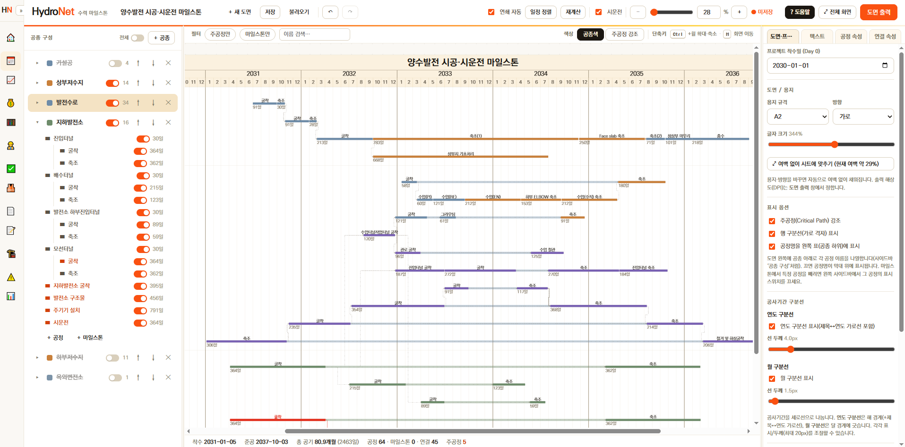
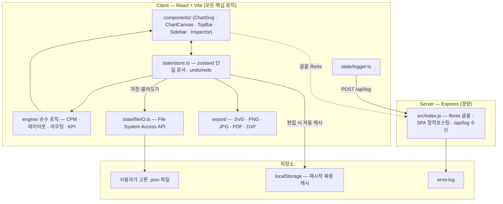

# HydroNet — 댐·양수발전 시공 및 시운전 마일스톤 관리 프로그램

> 댐과 양수발전 건설 현장의 공종별 흐름(Flow)을 그물망(Network)처럼 연결하여, 시공부터 시운전까지의 마일스톤을 직관적으로 편집하고 A4~A0 대형 도면으로 깨짐 없이 출력하는 건설사업관리 프로그램.



HydroNet 실행 화면 — 기본 샘플 프로젝트(`OO댐 시공·시운전 마일스톤`)는 `DESIGN/milestone sample.png`와 동일한 형태의 마일스톤 공정표로 렌더링·편집·출력됩니다.

---

## ✨ 주요 기능

### ⓪ 건설사업관리 패키지 (대시보드 · 모듈)
마일스톤·CPM 공정표를 **백본**으로, 그 위에 사업 대시보드와 분야별 모듈을 얹은 **건설사업관리(CM) 패키지**입니다. 좌측 **모듈 레일**로 화면을 전환합니다(접기/펴기, 전체화면 미리보기 땐 자동 숨김).
- **첫 진입 = 대시보드 + 새 사업 설정** — 처음 열면 대시보드 위에 **새 사업 모달**이 떠 ① **사업명 입력**(필수) → ② **🔎 타당성조사·📐 기본설계·📑 실시설계·🏗️ 시공** 단계 선택 → ③ **시설물 유형 선택**(콘크리트 중력댐·아치식댐·중심코어형 록필댐(ECRD)·표면차수벽형 석괴댐(CFRD)·복합댐(CSG)·가동보/고정보·농업용 저수지·양수발전·안전성강화 **9종**)을 안내합니다. 입력한 **사업명은 대시보드·공정관리(도면 제목)에 모두 적용**되고, **선택한 단계 + 시설물 유형에 맞는 공종/공정 프리셋이 자동 세팅**됩니다. 설계 단계는 **예정공정표 + 마일스톤** 두 시트(상단 탭 전환), 시공은 마일스톤 시트만 갖습니다.
- **🏠 대시보드(연결형)** — 한 화면에서 항목들이 서로 연계됩니다. **EVM 헤드라인**(일정성과 SPI·원가성과 CPI·전체 실적, 1.00 기준 색칩)으로 공정·진척·원가를 한 줄로 묶고, **모듈 경보 패널**(품질 NCR·안전 사고·리스크·인허가·지연 공정… 클릭 시 해당 모듈로 이동), **예산 vs 실적 미니바**(계획 PV·실적 EV·집행 AC), **기준선(베이스라인) 대비 표류**, 다가오는 마일스톤(주공정 CP 표시), 모듈 바로가기(핵심수치 인라인)를 제공. 모든 지표는 단일 셀렉터(`engine/kpis.ts`)에서 산출해 진척·보고서 화면과 항상 일치합니다. 헤더 **⎯ 기준선 저장**으로 현재 일정을 박제해 이후 표류를 측정합니다.
- **📈 진척·실적** — 공정별 실적 진척률(%)을 슬라이더/숫자로 입력. 기간가중 전체 실적, **계획(일정상 경과) 대비 실적** 편차, 지연 공정(계획比 10%p↓) 강조.
- **사업비(2분리)** — 💰 **프로젝트 예산**(구분별 예산/집행/**잔액 자동**) · 🧮 **공사 사업비**(공종별 수량·단가·**금액=수량×단가 자동** 내역(BOQ)·공사비 합계).
- **기록형 모듈** — 👷 인력·장비 · ✅ 품질·검측 · 🦺 안전관리 · 📄 문서·도면 · 📝 인허가 · 🏗️ 시운전 · ⚠️ 리스크·이슈. 모듈별 표(추가·인라인 수정·삭제, 숫자열 자동 합계, 계산 컬럼 자동)로 입력하며 사업 데이터에 함께 기록됩니다(`저장` 시 파일에 포함).
- **📊 보고서** — 공정·진척·각 모듈 현황을 자동 집계한 요약 화면 + **🖨 인쇄(PDF)**.

> 모든 모듈 데이터는 한 사업(`Project`) 파일에 직렬화됩니다. **원가 EVM·베이스라인·연결형 대시보드는 반영 완료**. 진척 모듈↔EV 환류·EVM 이중입력원 정합·자원 부하 히트맵·모듈↔공정 id 연계 집계 등 '의미 연계' 고도화는 순차 진행(설계 문서: `PACKAGE_PLAN.md`).

### ① 공종별 공정 · 마일스톤 관리
- **공종 → 공정 좌측 표(WBS)** — 도면 왼쪽에 각 공종을 헤더로 두고 그 아래에 **공정 이름을 한 줄씩 나열**합니다(사이드바 ‘공종 구성’ 트리와 동일). 한 줄 패키지(여러 공정이 한 줄)·마일스톤은 기존대로 막대/다이아몬드에 이름을 표기합니다. **표시 옵션**의 `공정명을 왼쪽 표(공종 하위)에 표시`로 끄면 공정명이 막대 위로 돌아갑니다. 특정 공정을 마일스톤에서만 빼려면 사이드바에서 그 공정의 표시 스위치를 끄세요(공종 구성엔 유지)
- **시설물 유형별 공정 프리셋(9종)** — 콘크리트 중력댐·아치식댐·중심코어형 록필댐(ECRD)·표면차수벽형 석괴댐(CFRD)·복합댐(CSG)·가동보/고정보·농업용 저수지·양수발전·안전성강화 각 유형에 **표준 공종·공정(공기)이 내장**되어, 새 사업에서 시설물 유형을 고르면 해당 공정표가 자동 구성됩니다(`data/facilities.ts`)
- **댐/양수발전 맞춤 템플릿** — 가설공·가물막이·접근수로·조절부·도류부·여수로·감세지·취수탑·제수변실·부대공·시운전 등 표준 공종 12종 기본 제공
- **세부공종(하위 공종) 표시** — 각 공정에 `세부공종`을 지정하면 도면 좌측 공종명 아래에 세부공종 행으로 묶여 표시됩니다 (예: `가물막이` → `상류 가물막이`·`하류 가물막이`·`유수전환`)
- **드래그로 순서·공종 변경** — 공정마다 한 줄로 표시되며, 좌측 사이드바나 도면에서 공정·마일스톤을 끌어 **같은 공종 안에서 원하는 위치로 순서를 바꾸거나** 다른 공종으로 이동할 수 있습니다. 사이드바와 도면(막대)의 순서는 항상 함께 움직입니다 (도면에선 막대를 위/아래로 드래그, 좌우 드래그는 일정 변경)
- **공종(레인) 드래그·삭제·이름 수정** — 사이드바에서 **공종 행을 드래그**해 위/아래로 재배치(도면 레인 순서도 함께 바뀜). 행 오른쪽 **✕**로 공종 삭제(포함 공정도 함께 삭제, 확인 후). 공종·공정 이름은 **더블클릭**으로 그 자리에서 수정
- **공종 다중 선택 · 복사/붙여넣기** — 공종을 **Ctrl+클릭**(누적)·**Shift+클릭**(범위)으로 여러 개 선택하고 **Ctrl+C → Ctrl+V**로 그 공종들(+공정·내부 연결)을 통째로 복제
- **표시 ON/OFF** — 좌측 사이드바의 각 공종·공정 옆 스위치로 도면에 표시할 항목만 켜고 끕니다(맨 위 전체 ON/OFF 포함). 끈 항목은 사이드바엔 흐리게 남고 도면·출력에서만 빠집니다
- **예정공정표 ↔ 마일스톤 연동** — 설계 사업의 **시공 마일스톤 시트**에서 좌측 `예정공정표 공정 함께 표시` 스위치를 켜면, **예정공정표 시트의 공종·공정이 같은 공종 아래로 함께 표시**됩니다(같은 이름 공종은 합치고, 없는 공종은 새 🔗 레인으로 추가 — 표시 전용). 각 🔗 공정의 스위치로 **마일스톤에서만 개별 공정을 숨길 수 있고**(예정공정표 원본은 그대로 유지), 표시된 공정은 도면 출력에도 함께 포함됩니다
- **공종 접기(트리)** — 사이드바의 ▸/▾ 는 사이드바 목록만 접으며, 도면 레인은 항상 그대로 표시됩니다
- **가변형 시운전 모드** — 상단 `시운전` 토글로 시운전 공정을 즉시 포함/제외 (일반 댐 ↔ 양수발전)
- **마일스톤(◆)** — 초기 담수, 준공, 상업운전 등 핵심 전환점을 다이아몬드로 표시
- **주공정(CP) 수동 지정** — 공정마다 `자동(CPM)·지정·제외`를 선택할 수 있고, 주공정은 도면에서 빨간 바·확대된 빨간 마일스톤·빨간 라벨로 두드러지게 표시됩니다

### ② 화살표 연계(네트워크 그래프) 엔진
- **드래그 연결 (앞·뒤 양쪽)** — 공정을 선택하면 막대 **앞·뒤 양 끝에 ●**가 나타납니다. 어느 쪽 ●에서든 끌어 다른 공정의 **앞 또는 뒤**에 놓으면, 출발·도착 끝점 조합으로 **FS·SS·FF·SF**가 자동 결정됩니다(종료→시작=FS, 시작→시작=SS, 종료→종료=FF, 시작→종료=SF). 관계는 연결을 클릭해 우측에서 바꿀 수도 있습니다
- **직교 라우팅 · 화살표 수렴** — 바 위치가 바뀌어도 화살표가 우회하여 깔끔하게 연결됩니다. 한 막대로 들어오거나 나가는 **여러 화살표는 그 막대의 중심으로 수렴**해 한 접점에서 하나처럼 모입니다(세로/가로 구간이 어긋나 계단처럼 처지지 않음)
- **화살표 클릭 편집** — 화살표(연결선)를 클릭하면 우측에서 **관계(FS/SS/FF/SF)·지연(일)·선 스타일(실선/파선/점선)**을 바꾸거나 삭제할 수 있습니다. 가는 선·점선의 빈칸까지 잡히도록 **클릭 영역을 넉넉히(약 14px)** 잡아, 마일스톤에 붙는 화살표도 쉽게 선택됩니다
- **지연일수(lag) ↔ 위치 상호작용** — 지연(lag)과 막대 위치가 **양방향으로 연동**됩니다. ① 지연(일)에 숫자를 넣거나 관계를 바꾸면 후행 공정이 **FS/SS/FF/SF + lag가 정확히 맞는 위치로** 이동하고, ② 반대로 **연결된 막대를 드래그해 옮기면 그 위치에 맞춰 지연(일)이 자동으로 다시 계산**됩니다(뒤로 밀면 +, 선행 종료보다 앞서면 −). 선행이 함께 움직이면 간격이 보존돼 지연은 그대로. 선행이 여럿이면 가장 늦은 제약을 따릅니다
- **DUMMY(가상·연결) 공정** — 막대 **우클릭**(또는 인스펙터 체크)으로 특정 공정을 더미로 지정하면 **공종색 60% 투명** 막대로 표시됩니다. 또한 같은 줄(한 줄 패키지)에서 **공정 사이 빈 구간**도 같은 색 60% 투명으로 자동 채워져 패키지가 끊김 없이 이어져 보입니다(CPM 계산엔 일반 공정과 동일 참여)
- **연쇄 수정(CPM)** — 선행 공정 기간이 늘어나면 후행 공정이 자동으로 뒤로 밀리고(`연쇄 자동`), 전체 준공일과 주공정(Critical Path)을 실시간 재계산

### ③ 용지 설정 · 고해상도 출력
- **가상 캔버스** — A4·A3·A2·A1·A0 규격과 가로/세로 방향 선택
- **벡터 렌더링(SVG)** — 화면과 동일한 SVG 원본을 용지 DPI로 래스터화하여 A0에서도 글씨·화살표가 깨지지 않음
- **출력 해상도 96~600 DPI** — A4~A2는 600DPI까지 원본 그대로, A1·A0 등 대형 용지는 메모리 보호를 위해 자동 클램프(조정된 DPI 안내 표시)
- **여백 없이 시트에 맞추기 (실시간)** — 오른쪽 **도면 / 용지** 패널에서 용지(A4~A0)·방향을 바꾸면 즉시 그 규격에 맞춰 **여백(레터박스) 없이 꽉 채웁니다**(시간축·행 높이 밀도만 조정 → 글자·막대 왜곡 없음). 규격을 바꿔가며 결과를 실시간으로 확인하며 작도할 수 있습니다. 출력 창에도 동일한 `⤢ 여백 없이 시트에 맞추기` 버튼이 있습니다
- **규격에 맞춘 글자 크기** — 큰 용지에 채우면 글자가 상대적으로 작아져 출력 시 안 보일 수 있어, 용지에 맞출 때 **글자 크기를 규격에 맞게 자동 확대**(읽기 좋은 인쇄 크기로, 정상 도면은 줄이지 않음)합니다. 도면/용지 패널의 **글자 크기 슬라이더**로 직접 조정도 가능하며, 화면·PNG·JPG·PDF·DXF에 모두 반영됩니다. (출력 해상도(DPI)는 출력 창에서 설정)
- **원클릭 내보내기** — `SVG`(벡터 원본·일러스트레이터(AI)에서 바로 편집) · `PNG`(무손실) · `JPG`(경량) · `PDF`(인쇄용 용지 규격) · **`DXF`(캐드)** — AutoCAD에서 열어 편집/`DWG` 저장. 텍스트=TEXT, 화살표=폴리라인, 마일스톤=폴리라인, 막대=SOLID 채움, 격자/축=선, **도면 구분선(제목·연도/월·헤더)·외곽 테두리·막대 테두리까지 화면과 동일하게** 포함, 공종별 레이어 분리(R12/AC1009)
- **도면 제목 · CI** — 상단 중앙에 볼드 도면 제목(프로젝트명). 제목은 **도면에서 글자를 클릭**하면 우측 **텍스트** 탭에서 표시 ON/OFF·글꼴·크기·색을 편집합니다. 우측 하단 CI 로고(기본 `CI_Saman`)는 인스펙터 **도면·프로젝트** 탭의 **CI** 구간에서 **＋ CI 이미지 추가**(PNG·JPG·GIF·SVG)로 넣고, 도면 위 **좌하단 모서리 핸들 드래그로 크기 조절**·**◀▶ 로 배치 순서 변경**(여러 개는 우측부터)합니다. 출력물에 함께 포함됩니다.

### ④ 우기(雨期) 보정 시각화
- 장마철 구간을 회색 음영 밴드로 연도별 자동 표시 (댐 공사 일정 검토용)
- **일(日) 단위 설정** — 시작/종료를 월+일로 지정. 도면에서 **밴드 양 끝을 드래그**해 조절하며, 한 해를 바꾸면 모든 해의 우기가 동일하게 변동

### ⑥ 저장 · 불러오기 (수동 — 경로 직접 지정)
- **자동저장 없음 · 수동 저장** — 상단바 `저장`(또는 `Ctrl/⌘ + S`)을 눌렀을 때만 저장됩니다. 저장하지 않은 변경이 있으면 상단에 **`● 미저장`**, 저장 후엔 `저장됨`으로 표시됩니다
- **원하는 경로에 저장** — `저장`을 누르면 **저장 위치·파일명을 직접 고르는 창**이 뜹니다(크롬·엣지 등 폴더 선택 지원 브라우저·localhost·https). 단일 HTML(`file://`)이나 LAN(http)처럼 폴더 선택이 막힌 환경에서는 **다운로드**로 저장됩니다(브라우저 설정에서 "다운로드 시 저장 위치 확인"을 켜면 경로 선택 가능)
- **원하는 경로에서 불러오기** — 상단바 `불러오기` 버튼으로 **파일 선택창**을 열어 어느 폴더의 `.json`이든 불러옵니다
- **형식** — 순수 JSON(`.json`)으로 저장해 의존성 없이 가장 빠르게 로딩. 프로젝트 전체(공정표 시트·모듈 기록·기준선 포함)가 한 파일에 직렬화됩니다

### ⑤ 텍스트 스타일 · 즐겨찾기 · 재계산 확인
- **속성 4탭** — 오른쪽 속성 패널이 **도면·프로젝트 / 텍스트 / 공정 속성 / 연결 속성** 4개 탭으로 구성됩니다. 차트에서 공정·연결·글자를 클릭하면 **해당 탭으로 자동 전환**되고, 탭을 직접 눌러 원하는 속성을 바로 편집·스타일화할 수도 있습니다(크림/오렌지 테마)
- **텍스트 클릭 편집** — 도면 위 모든 텍스트(제목·공종·세부공종·공정명·기간·마일스톤·축·우기 라벨)를 클릭하면 **텍스트** 탭에서 **글자 크기(pt)·글꼴·색상**을 역할별로 조정합니다(텍스트 탭에서 대상 종류를 골라서도 편집 가능). 제목은 같은 탭에서 **상단 제목 표시 ON/OFF**까지 켜고 끕니다. 글자 크기를 키우면 **제목 띠·헤더·행 높이·좌측 라벨 칸이 자동으로 함께 커져** 글자가 잘리거나 차트를 침범하지 않습니다(공종명·"공종/마일스톤" 헤더가 간트 영역으로 넘어오지 않음). **공사 일수는 막대 아래**에 배치되어 막대와 겹치지 않습니다. ※ 연/월 축 텍스트를 클릭하면 표시 기간 설정이 열리므로, 축 글자 스타일은 텍스트 탭에서 `연도 축`·`월 축`을 골라 편집합니다
- **색상 즐겨찾기 Palette** — 공정 속성의 색상·종료일 아래 **5×2(최대 10개)** 팔레트. 빈 칸 `＋`로 현재 색을 저장, 클릭으로 적용, 우클릭으로 삭제
- **재계산 결과 팝업** — `재계산`·`일정 정렬` 실행 시 어떤 공정이 어떻게(시작일 이전→이후) 이동했는지 화면 중앙 팝업으로 표시 (닫기 버튼·`Esc`·부드러운 열림/닫힘 애니메이션)
- **도움말(?)** — 상단바 `? 도움말` 버튼으로 사용 방법·마우스 조작·캔버스 도구·단축키 안내 모달을 표시

### ⑦ 보기 편의 · 빠른 작성
- **필터(차트 위 보기 막대)** — `주공정만`·`마일스톤만` 칩과 **이름 검색**으로 복잡한 도면에서 원하는 항목만 추려 봅니다(왼쪽 목록도 함께 추려짐). `필터 해제`로 전체 복귀. 필터는 **화면 검토용**이며 **출력물은 항상 전체 도면**으로 나갑니다(내보내기 시 자동으로 전체를 그려 저장 후 보기 상태 복원)
- **색상 모드** — `공종색`(레인별 색) ↔ `주공정 강조`(주공정만 빨강·나머지는 회색으로 흐리게). 주공정 강조는 `주공정 표시` 체크와 무관하게 동작
- **오늘 선** — 시작일 기준 ‘오늘’ 위치에 세로 점선 표시(화면 전용 — 출력물에는 포함되지 않음)
- **표시 기간 설정** — 마일스톤 **상단의 연/월을 클릭**하면 팝업이 열려, 타임라인에 표시할 **시작~종료 월**을 직접 지정할 수 있습니다. 지정한 구간만 정확히 표시되며(데이터가 더 길어도 그 구간만, 짧아도 빈 기간 포함), `자동으로 초기화`로 데이터 범위(착수~준공)로 되돌립니다
- **이름 바로 편집** — 도면의 바·마일스톤을 **더블클릭**하면 그 자리에서 이름을 입력(`Enter` 적용·`Esc` 취소). 사이드바의 공종·공정 이름도 더블클릭으로 수정
- **공기(기간) 텍스트 편집** — 막대 아래 `○일` 텍스트를 **더블클릭**해 수정. **숫자만** 입력하면 기간(막대 길이)이 바뀌고, `약 2개월`처럼 **문자**를 넣으면 그 텍스트가 그대로 표시됩니다(빈칸으로 두면 자동 `○일` 복귀)
- **빈 레인 더블클릭으로 공정 추가** — 공종 레인의 빈 영역을 더블클릭하면 그 위치에 공정이 생기고 바로 이름을 입력(필터가 켜진 상태에서는 비활성)
- **새 도면 템플릿 갤러리** — 상단 `＋ 새 도면`에서 **댐 시공·시운전 / 양수발전 / 간단 마일스톤 / 빈 프로젝트** 템플릿을 골라 시작
- **단축키 안내(보기 막대)** — 차트 위 보기 막대 오른쪽에 `Ctrl+휠`(차트 확대·축소)·`H`(드래그로 화면 이동) 캔버스 도구 단축키를 표시합니다. (이전의 ‘간단/전문가’ 보기 모드는 제거 — 일정 정렬·재계산, SVG/DXF·고DPI 출력, 주공정 수동 지정 등 **모든 기능이 항상 표시**됩니다)

---

## 🧱 기술 스택

| 영역 | 선택 | 비고 |
|---|---|---|
| 프론트엔드 | **React 18 + Vite + TypeScript** | 모든 핵심 로직(엔진·렌더·출력)을 클라이언트에서 수행 |
| 상태 관리 | **zustand** | 경량(undo/redo·수동 파일 저장) |
| 다이어그램 | **SVG 직접 렌더링** | 외부 차트 라이브러리 미사용 → 번들 경량 |
| 출력 | **Canvas + jsPDF** | SVG→고해상도 PNG/JPG/PDF |
| 백엔드 | **Express (Node)** | 파일 기반 저장 + 중앙 `error.log` |

> **경량 설계** — 모든 무거운 연산은 브라우저에서 수행하고 백엔드는 파일 저장/로깅만 담당합니다. 추후 **Electron** 으로 감싸 인터넷이 없는 오지 현장에서도 단독 실행되는 `.exe` 배포가 가능하도록 설계했습니다.

> **글꼴** — 화면·공정표에 **KoPubWorld Dotum_Pro**(제목·공종 **Bold**, 나머지 **Medium**). 폰트는 서버가 아니라 **접속한 각 PC(브라우저)** 에서 렌더링됩니다.
> - **LAN 화면 적용**: `KoPubWorld Dotum_Pro Medium.otf` · `KoPubWorld Dotum_Pro Bold.otf` 2개를 `client/public/fonts/`에 넣고 **서버만 재시작**하면(서버가 `/fonts`를 직접 서빙 → 재빌드 불필요) 모든 LAN 클라이언트 화면에 자동 적용됩니다.
> - **도면 출력물**: 래스터화 시 OS에 **설치된** 폰트만 사용되므로, 도면을 출력하는 PC에는 OTF를 **설치**하세요. 미설치·미번들 시 `Malgun Gothic` 대체. 자세한 안내: `client/public/fonts/README.txt`.

---

## 🏗️ 아키텍처

> GitHub·Gitea는 아래 `mermaid` 코드블록을 **네이티브로 렌더링**합니다(별도 빌드·이미지 불필요). 코드가 바뀌면 이 다이어그램도 함께 갱신하세요.



---

## 📂 프로젝트 구조

```
HydroNet/
├─ client/                  # React + Vite 프론트엔드
│  ├─ src/
│  │  ├─ engine/            # 순수 로직 (DOM 비의존)
│  │  │  ├─ scheduling.ts   #  · CPM(주공정/여유), 연쇄 수정, 재계산
│  │  │  ├─ layout.ts       #  · 좌표/레인 스태킹/타임라인/우기 밴드
│  │  │  ├─ routing.ts      #  · 의존성 화살표 직교 라우팅
│  │  │  ├─ paper.ts        #  · A4~A0 용지 치수/픽셀 산정
│  │  │  ├─ kpis.ts         #  · 단일 KPI 셀렉터(EVM·SPI/CPI·진척)
│  │  │  ├─ mirror.ts       #  · 예정공정표 ↔ 마일스톤 연동(augmentForMirror)
│  │  │  └─ dates.ts        #  · 날짜 ↔ Day offset 변환
│  │  ├─ components/        # ChartSvg, ChartCanvas, TopBar, Sidebar, Inspector …
│  │  ├─ export/            # exporter.ts(SVG/PNG/JPG/PDF) · dxf.ts(DXF/캐드)
│  │  ├─ state/             # store.ts(zustand)·api.ts·logger.ts·fileIO.ts(파일 저장/열기)·shell.ts(모듈 레일)
│  │  ├─ data/              # sampleProject.ts·templates.ts·facilities.ts(시설물 9종)·modules.ts(CM 모듈)·ciLogo.ts
│  │  └─ styles/            # 디자인 토큰 + 전역 CSS
│  └─ scripts/              # smoke.ts·mount-test.ts(빈화면 회귀)·build-single.ts·check-single.ts·dxf-check.ts·render-preview.ts
├─ server/                  # Express 백엔드 (파일 저장 + error.log)
│  ├─ src/index.js
│  └─ data/                 # 프로젝트 JSON 저장소
├─ start-lan.bat            # LAN 접속용 서버 실행 (0.0.0.0, 클라이언트+API 단일 포트)
├─ error.log                # 모든 프로그램 오류 기록 (ABS_RULE)
└─ package.json             # 루트 (dev 동시 실행)
```

---

## 🚀 실행 방법

### 사전 준비
- Node.js 18 이상 (개발은 Node 24 기준)

### 설치
```bash
npm install        # 루트 + client + server 일괄 설치 (postinstall)
```

### 개발 모드 (서버 + 클라이언트 동시 실행)
```bash
npm run dev
# 클라이언트: http://localhost:5173
# 서버 API : http://localhost:4020  (Vite가 /api 프록시)
```
> 서버를 띄우지 않아도 클라이언트는 동작합니다 — 이 경우 프로젝트는 브라우저 `localStorage`에 저장됩니다.

### 배포 빌드
```bash
npm run build      # client/dist 생성
node server/src/index.js   # dist가 있으면 서버가 정적 호스팅
```

### 📄 단일 HTML 파일 (서버·설치 없이 배포)
다른 사람에게 **HTML 파일 하나만** 주면 더블클릭으로 바로 쓸 수 있는 완전 독립형 빌드입니다.

> **바로 다운로드** — 빌드 없이 쓰려면 저장소의 **[`HydroNet.html`](HydroNet.html)** (현재 버전, 약 20MB)을 내려받아 더블클릭하세요. 직접 빌드하려면:

```bash
cd client
# 글꼴 내장이 필요하면 KoPubWorld Dotum_Pro Medium/Bold.otf 를 client/public/fonts/ 에 둠
npm run build:single      # → 저장소 루트에 HydroNet.html 생성 (약 20MB, KoPub 내장 시)
npx tsx scripts/check-single.ts   # (선택) jsdom으로 마운트 검증
```
- 모든 JS/CSS를 한 파일에 인라인하고, KoPub OTF를 base64로 `@font-face`에 내장합니다(어느 PC에서도 KoPub로 표시). 진입 스크립트는 **classic 스크립트(IIFE)** 로 만들어 `file://` 더블클릭에서도 실행됩니다.
- **되는 것**: 편집·모든 출력(PNG·JPG·PDF·SVG·DXF) — 전부 브라우저에서 처리(서버 불필요).
- **저장/불러오기**: `저장`(Ctrl/⌘+S)으로 **원하는 위치에 `.json` 파일**로 저장하고 `불러오기`로 다시 엽니다(자동저장 없음). 단일 HTML은 `file://`라 폴더 선택창 대신 **다운로드**로 저장될 수 있습니다(브라우저의 "다운로드 시 저장 위치 확인"을 켜면 경로 선택). 작업물 공유는 이 `.json` 파일 또는 내보내기를 사용하세요.
- 글꼴을 내장하지 않으면(설치 글꼴 사용) 파일은 ~1MB로 가벼워지고 한글은 받는 PC의 설치 글꼴(맑은 고딕 등)로 표시됩니다.

### 🌐 LAN(사내망)에서 다른 PC로 접속
오지 현장 사무실의 여러 PC가 한 대의 서버에 접속해 공유할 수 있습니다. 서버는
`0.0.0.0`(모든 네트워크 인터페이스)에 바인딩되어 클라이언트(빌드본) + API를
한 포트(기본 4020)로 함께 제공합니다. (개발=4020 / 운영=4000 권장)

```bat
start-lan.bat          ◀ 더블클릭 (최초 1회 자동 빌드)
```
실행하면 콘솔에 접속 주소가 표시됩니다:
```
Local: http://127.0.0.1:4020/
LAN:   http://192.168.x.x:4020/      ← 다른 PC는 이 주소로 접속
```
> 다른 PC에서 LAN 주소가 안 열리면 서버 PC의 Windows Defender 방화벽에서 TCP 4020 포트를 허용하세요:
> ```
> netsh advfirewall firewall add rule name="HydroNet 4020" dir=in action=allow protocol=TCP localport=4020
> ```
> 포트 변경: 실행 전 `set PORT=4000` 등으로 지정 가능(미지정 시 4020). 개발은 4020, 운영은 4000을 권장합니다.

### 검증 스크립트
```bash
cd client
npx tsx scripts/smoke.ts            # 엔진(CPM/레이아웃/라우팅) 무결성 검사
npx tsx scripts/mount-test.ts       # jsdom 전체앱 마운트 — 빈화면 회귀 방지(커밋 전 필수)
npx tsx scripts/render-preview.ts   # preview.png 로 마일스톤 출력 미리보기
```

---

## ⌨️ 단축키

| 키 | 동작 |
|---|---|
| `Ctrl/⌘ + S` | 저장 (파일로 — 경로 선택) |
| `Ctrl/⌘ + Z` / `Ctrl + Y` | 실행 취소 / 다시 실행 |
| `Ctrl/⌘ + C` / `Ctrl/⌘ + V` | 선택한 공종 복사 / 붙여넣기 |
| `Delete` / `Backspace` | 선택한 공정·연결 삭제 |
| `Ctrl/⌘ + 마우스 휠` | **차트 확대/축소** — 커서 위치 기준. 이 페이지에선 브라우저 페이지 줌 대신 차트만 확대/축소(트랙패드 핀치도 동일) |
| `Ctrl/⌘ + 클릭` | 막대(공정·마일스톤) **다중 선택** 누적 |
| `H` | **이동(Hand) 모드** — 화면을 드래그해 이동 |
| `V` / `Esc` | 일반 편집 모드로 복귀 (Esc는 연결 드래그도 취소) |

조작: 바를 **드래그**하여 이동, 선택 후 우측 끝 **●를 다른 공정으로 드래그**하여 연결.

**화면 조작**
- **공정 기간 조절** — 공정 바를 선택하면 양 끝에 나타나는 핸들을 드래그해 기간을 늘리거나 줄임 (가운데를 드래그하면 이동, 오른쪽 끝 ● 는 연결용)
- **패널 너비 조절** — 좌/우 사이드바 경계를 마우스로 드래그 (너비는 자동 저장)
- **배율** — 우측 상단 슬라이더·숫자 입력 또는 `＋/−` 로 차트 **전체(가로·세로·글자)** 를 균일하게 확대/축소
- **확대/축소(Ctrl+휠)** — `Ctrl/⌘ + 마우스 휠` 로 차트를 **커서 위치 기준**으로 확대/축소합니다. 이 페이지에서는 브라우저의 페이지 전체 줌(Ctrl+휠)을 막아 **차트만** 확대/축소되며, 트랙패드 핀치도 동일하게 동작합니다
- **이동(Hand) 도구** — `H` 누르면 이동 모드(드래그로 화면 스크롤), `V`/`Esc` 로 일반 편집 모드 복귀(상단 배지로 모드 표시)
- **막대 다중 선택 · 동시 이동** — 빈 곳에서 **드래그(고무줄)** 하면 사각형 범위 안의 막대·마일스톤이 모두 선택되고, `Ctrl/⌘+클릭` 으로 하나씩 추가 선택도 됩니다. 선택된 막대 하나를 끌면 **선택 전체가 함께 수평 이동**합니다
- **화살표 드래그 자동 스크롤** — 연결 화살표나 막대를 드래그할 때 화면 가장자리에 닿으면 캔버스가 자동으로 스크롤되어, **화면 밖 아래/위 공종까지** 끌어갈 수 있습니다
- **전체 화면** — `⤢ 전체 화면` 버튼으로 패널을 숨기고 전체 화면 미리보기(출력 전 확인), `Esc` 로 종료

---

## 🛡️ 개발 절대 원칙 (ABS_RULE) 준수

- **오류 로깅** — 클라이언트/서버의 모든 오류는 루트 `error.log`에 기록됩니다. (`state/logger.ts` → `POST /api/log` → 서버 append). 식별된 오류는 수정 후 재발하지 않도록 관리합니다.
- **GitHub 연동** — 본 저장소는 https://github.com/hjlee624/HydroNet.git 와 함께 갑니다. 주요 내용 변경 시 README도 함께 갱신합니다.
- **.gitignore** — `node_modules`, 빌드 산출물, `error.log`, 런타임 프로젝트 데이터, 미리보기 산출물 제외.

---

## 🗺️ 로드맵

- [x] 1~4단계: 공정 엔진 · CPM · 화살표 라우팅 · 도면 출력
- [x] 사용성 빠른개선: 보기 필터·색상·오늘선 · 인라인 이름편집 · 새 도면 템플릿 갤러리 (간단/전문가 모드는 이후 제거 — 전체 기능 상시 노출)
- [x] 건설사업관리(CM) 패키지: 연결형 대시보드·EVM·베이스라인·분야별 모듈 · 시설물 유형 9종 프리셋 · WBS 좌측 표 · 화살표 양끝 연결(FS/SS/FF/SF)+지연↔위치 양방향
- [ ] 5단계: 현장 데이터 기반 안정화, 대용량 렌더링 최적화
- [ ] 기상 데이터 연동(우기 자동 보정), 보수보강 전용 타임라인
- [ ] **Electron 패키징** → 오프라인 `.exe` 배포

---

<sub>최종 갱신 · 2026-07-02 · <code>dev</code> 브랜치 기준</sub>
