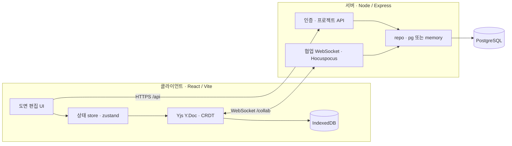
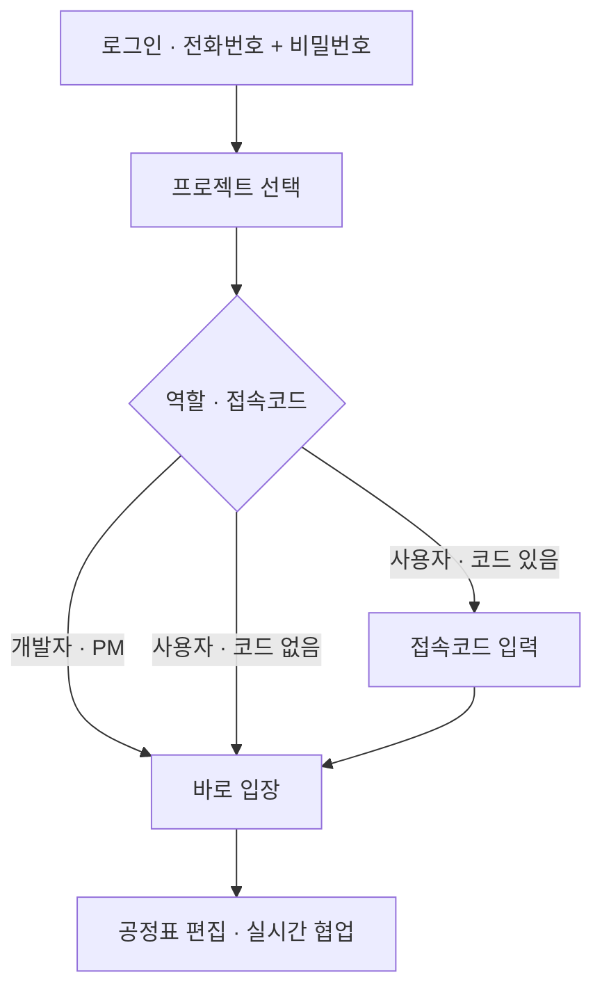

# Sequence

<p align="center">
  
</p>

**토목 설계·시공 공정표(예정공정표 · 마일스톤) 관리 프로그램**

Sequence 는 토목 전 분야(도로·교량·터널·하천·상하수도·항만·철도·단지·지반·수자원/댐 등)의
**공정표를 그리고, 일정을 계산하고, 도면으로 출력**하는 웹 애플리케이션입니다. 시설물 유형을
고르면 그 유형의 표준 공종·공정 프리셋으로 공정표가 세팅되고, 막대를 끌어 일정을 잡으면
선후행(CPM)·주공정·전체 공기가 실시간으로 계산됩니다.

---

## 주요 기능

- **전사공통 시설물 프리셋** — 11개 분야 43종(도로·공항 / 교량 / 터널 / 하천·방재 / 상수도 /
  하수도 / 항만·해안 / 철도·궤도 / 단지·부지 / 지반·기초 / 환경·정화 / 수자원·댐) 각각의 표준
  시공 공정표(공종·공정·마일스톤) 템플릿.
- **새 도면 마법사** — 도면 유형(타당성 / 기본설계 / 실시설계 / 시공)과 시설물 유형을
  검색·선택하고, 시작 전 **공정표 샘플(총 공기·공종·마일스톤)** 을 미리 봅니다.
- **일정 엔진(CPM)** — 선후행(FS/SS/FF/SF·지연) 연결, 주공정(Critical Path)·여유(Float)
  자동 계산, 연쇄 자동 이동·일정 정렬·재계산.
- **예정공정표 ↔ 마일스톤 연동** — 설계 단계 사업은 예정공정표와 시공 마일스톤 시트를 함께 관리.
- **우기 음영**, 연도/월 구분선, WBS(공종·세부공종) 좌측 라벨, 자유로운 막대 이동(날짜 제약 없음).
- **실시간 협업** — 같은 프로젝트에 동시 접속 시 다른 참여자의 커서·선택 위치가 이름·역할
  (관리자/사용자) 배지로 표시(Yjs/CRDT 기반).
- **본부(조직 단위) · 권한(RBAC)** — 11개 본부(경영전략/물환경/수자원/국토개발/철도/도로/플랜트/
  CM/해외사업/사업개발실/안전품질관리실, 각 본부 심볼 포함). 프로젝트는 한 본부에 속하며 **같은
  본부만** 조회/입장 가능(개발자는 전체).
  - **개발자** — 전체 본부·프로젝트 관리(생성/삭제/활성·비활성). 대시보드는 **왼쪽 본부 목록에서
    본부를 클릭**해야 그 본부의 프로젝트가 보입니다.
  - **관리자(PM)** — 소속 본부의 모든 프로젝트 입장 가능(담당은 편집, 담당 아니면 조회 전용).
  - **사용자** — 소속 본부 프로젝트를 목록에서 보되, 배정된 프로젝트만 입장·편집.
- **셀프 등록 · 비밀번호 관리** — 로그인 화면 ‘사용자 등록’에서 역할(관리자/사용자)·본부·이름·
  전화번호(ID)·비밀번호로 가입. 비밀번호는 **8~12자, 영문·숫자·특수기호(!@#$%^&\*) 중 2종 이상**.
  사용자는 즉시 로그인, 관리자는 개발자 승인 후 로그인(개발자 대시보드·관리자 도구에 **요청 시각**과
  함께 승인 대기 표시). 로그인 5회 실패 시 **비밀번호 초기화 요청**(관리자에게 전달 → 관리자가 새
  비밀번호를 직접 지정), 로그인 후 **본인 비밀번호 변경** 가능. 구 정책(4자리) 계정은 다음 로그인
  때 새 비밀번호로 **변경 강제**.
- **참여 인원 관리** — 프로젝트별로 **본부를 선택하면 소속 인원이 체크박스 목록**으로 나오고,
  여러 명을 **한 번에 추가**(인원별로 관리자/사용자 권한 지정). 개발자·PM이 관리.
- **도면 출력** — A4~A0, 가로/세로, SVG · PNG · JPG · PDF · DXF, DPI 조절, 용지 맞춤.
- **동적 로그인 배경** — 마우스에 반응하는 패럴랙스 모션 배경.

---

## 기술 스택

| 영역 | 스택 |
|------|------|
| Client | React 18 · TypeScript · Vite · Zustand · Yjs(+y-indexeddb) · jsPDF |
| Server | Node.js · Express · Hocuspocus(WebSocket) · PostgreSQL(또는 파일 기반 메모리 저장소) |
| 협업/영속 | CRDT(Y.Doc) — room = projectId, IndexedDB(로컬) + 서버 영속 |
| 품질 | Biome(lint · format) |

요구 런타임: **Node.js ≥ 24 < 25**, **npm ≥ 11**.

---

## 아키텍처



## 접속 흐름



---

## 프로젝트 구조

```
Sequence/
├─ client/            # React + Vite 프런트엔드
│  ├─ src/
│  │  ├─ components/  # 차트·도면·다이얼로그·인증 UI
│  │  ├─ data/        # 시설물 유형·공정표 프리셋(facilities, civilFacilities, templates)
│  │  ├─ engine/      # 일정(CPM)·레이아웃·라우팅·날짜
│  │  ├─ export/      # SVG/PNG/PDF/DXF 출력
│  │  └─ state/       # store(zustand) · crdt · collaboration · auth
│  └─ public/         # 폰트·PWA·프리셋 애셋
├─ server/            # Express + Hocuspocus 협업/인증 서버
│  └─ src/{auth,collab}/
└─ package.json       # 워크스페이스 스크립트(concurrently)
```

---

## 개발

```bash
npm install          # 루트 + client + server 의존성 설치(postinstall)
npm run dev          # 서버 + 클라이언트 동시 실행(concurrently)
npm run build        # 클라이언트 프로덕션 빌드(tsc --noEmit && vite build)
npm run lint         # Biome 린트
npm run check:fix    # Biome 린트+포맷 자동수정
```

개별 실행:

```bash
npm run dev:client   # Vite 개발 서버만
npm run dev:server   # 협업/인증 서버만
```

### 사내망(LAN) 실행

`start-lan.bat` 로 LAN 접속용 서버를 기동합니다. 서버가 없으면 클라이언트는 자동으로
오프라인(로컬 단일 사용자) 모드로 동작합니다.

### 단일 HTML 배포본

```bash
npm --prefix client run build:single   # → Sequence.html (오프라인 단독 실행 파일)
```

---

## 배포 / 서버 설정

- **DB** — 운영은 PostgreSQL(`AUTH_BACKEND=pg`, `DATABASE_URL`). 스키마: `server/db/schema.sql`.
  파일 기반 메모리 저장소로도 동작(소규모/사내).
- **초기 계정** — 사용자가 하나도 없으면 환경변수(`AUTH_BOOTSTRAP_USER` /
  `AUTH_BOOTSTRAP_PASSWORD`, 기본 `admin` / `Sequence1!`)로 개발자 계정을 시드합니다.
  운영에선 `AUTH_BOOTSTRAP_PASSWORD`를 반드시 재설정하세요.
- **권한** — 개발자(전체) · PM(담당 프로젝트) · 사용자(부여받은 프로젝트).
- **승인·초기화 알림(옵션)** — 계정 신청·비밀번호 초기화 요청을 **네이버웍스(NAVER WORKS) Bot**으로
  운영자에게 DM 발송(`WORKS_*` 환경변수 설정 시, `server/.env.example` 참고). 미설정이면 인앱 표시만.

### 전사 배포 · 계정 일괄 등록

1. **명부 업로드** — 관리자 도구에서 사내 명부 엑셀(`전화번호` · `이름` · `그룹` 열)을 올리면
   전 직원 계정이 한 번에 생성됩니다. **초기 비밀번호 = 전화번호 뒤 4자리**(현 비밀번호 정책 미충족이라
   각자 **최초 로그인 시 새 비밀번호로 변경**하게 됩니다).
   (또는 `username · name · role · password` 열의 일반 CSV/엑셀도 지원.)
2. **로그인** — 아이디 = 전화번호(010-…), 비밀번호 = 뒤 4자리로 각자 접속.
3. **테스트 프로젝트** — 접속코드 없이 만든 프로젝트에 인원을 배정하면, 배정된 관리자·
   사용자는 코드 없이 바로 입장해 함께 테스트할 수 있습니다.

---

## 브랜치

이 저장소의 `Sequence` 브랜치가 Sequence 애플리케이션 전용 라인입니다.
