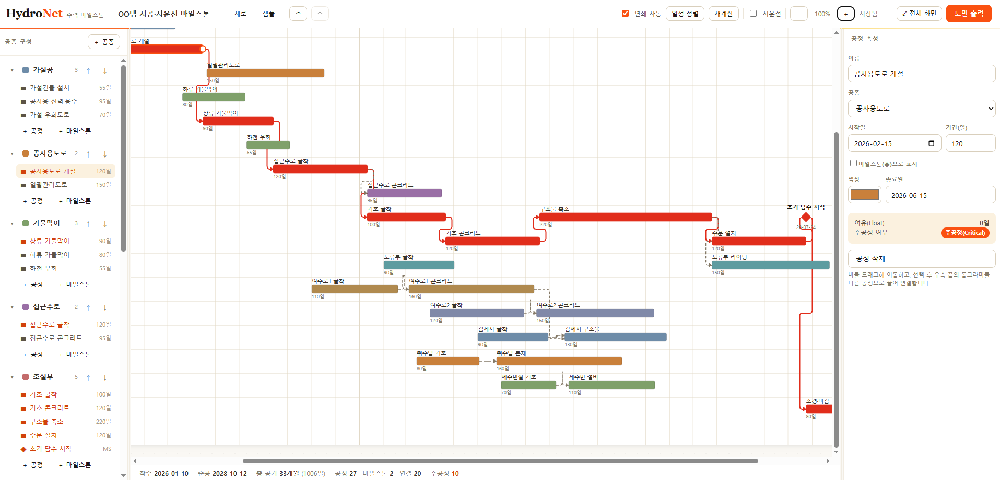

# HydroNet — 댐·양수발전 시공 및 시운전 마일스톤 관리 프로그램

> 댐과 양수발전 건설 현장의 공종별 흐름(Flow)을 그물망(Network)처럼 연결하여, 시공부터 시운전까지의 마일스톤을 직관적으로 편집하고 A4~A0 대형 도면으로 깨짐 없이 출력하는 건설사업관리 프로그램.



HydroNet 실행 화면 — 기본 샘플 프로젝트(`OO댐 시공·시운전 마일스톤`)는 `DESIGN/milestone sample.png`와 동일한 형태의 마일스톤 공정표로 렌더링·편집·출력됩니다.

---

## ✨ 주요 기능

### ① 공종별 공정 · 마일스톤 관리
- **댐/양수발전 맞춤 템플릿** — 가설공·가물막이·접근수로·조절부·도류부·여수로·감세지·취수탑·제수변실·부대공·시운전 등 표준 공종 12종 기본 제공
- **세부공종(하위 공종) 표시** — 각 공정에 `세부공종`을 지정하면 도면 좌측 공종명 아래에 세부공종 행으로 묶여 표시됩니다 (예: `가물막이` → `상류 가물막이`·`하류 가물막이`·`유수전환`)
- **드래그로 공종 이동** — 좌측 사이드바에서 공정·마일스톤을 끌어다 다른 공종 위에 놓으면 소속 공종이 바뀝니다 (인스펙터 드롭다운으로도 가능)
- **표시 ON/OFF** — 좌측 사이드바의 각 공종·공정 옆 스위치로 도면에 표시할 항목만 켜고 끕니다(맨 위 전체 ON/OFF 포함). 끈 항목은 사이드바엔 흐리게 남고 도면·출력에서만 빠집니다
- **공종 접기(트리)** — 사이드바의 ▸/▾ 는 사이드바 목록만 접으며, 도면 레인은 항상 그대로 표시됩니다
- **가변형 시운전 모드** — 상단 `시운전` 토글로 시운전 공정을 즉시 포함/제외 (일반 댐 ↔ 양수발전)
- **마일스톤(◆)** — 초기 담수, 준공, 상업운전 등 핵심 전환점을 다이아몬드로 표시
- **주공정(CP) 수동 지정** — 공정마다 `자동(CPM)·지정·제외`를 선택할 수 있고, 주공정은 도면에서 빨간 바·확대된 빨간 마일스톤·빨간 라벨로 두드러지게 표시됩니다

### ② 화살표 연계(네트워크 그래프) 엔진
- **드래그 연결** — 공정을 선택하면 끝점에 나타나는 ●를 다른 공정으로 끌어 화살표 생성
- **직교 라우팅** — 바 위치가 바뀌어도 화살표가 우회하여 깔끔하게 연결
- **연쇄 수정(CPM)** — 선행 공정 기간이 늘어나면 후행 공정이 자동으로 뒤로 밀리고(`연쇄 자동`), 전체 준공일과 주공정(Critical Path)을 실시간 재계산

### ③ 용지 설정 · 고해상도 출력
- **가상 캔버스** — A4·A3·A2·A1·A0 규격과 가로/세로 방향 선택
- **벡터 렌더링(SVG)** — 화면과 동일한 SVG 원본을 용지 DPI로 래스터화하여 A0에서도 글씨·화살표가 깨지지 않음
- **출력 해상도 96~600 DPI** — A4~A2는 600DPI까지 원본 그대로, A1·A0 등 대형 용지는 메모리 보호를 위해 자동 클램프(조정된 DPI 안내 표시)
- **원클릭 내보내기** — `SVG`(벡터 원본·일러스트레이터(AI)에서 바로 편집) · `PNG`(무손실) · `JPG`(경량) · `PDF`(인쇄용 용지 규격) · **`DXF`(캐드)** — AutoCAD에서 열어 편집/`DWG` 저장. 텍스트=TEXT, 화살표=폴리라인, 마일스톤=폴리라인, 막대=SOLID 채움, 격자/축=선, 공종별 레이어 분리(R12/AC1009)
- **도면 제목 · CI** — 상단 중앙에 볼드 도면 제목(프로젝트명), 우측 하단에 CI 로고(기본 `CI_Saman`) 삽입. 인스펙터의 **＋ CI 이미지 추가**로 PNG·JPG·GIF·SVG 로고를 업로드하면 출력물에 함께 포함됩니다. 도면 위에서 **좌하단 모서리 핸들을 드래그해 크기 조절**, 인스펙터 **◀▶ 로 배치 순서 변경**(여러 개는 우측부터 차례로 배치).

### ④ 우기(雨期) 보정 시각화
- 장마철 구간을 회색 음영 밴드로 연도별 자동 표시 (댐 공사 일정 검토용)
- **일(日) 단위 설정** — 시작/종료를 월+일로 지정. 도면에서 **밴드 양 끝을 드래그**해 조절하며, 한 해를 바꾸면 모든 해의 우기가 동일하게 변동

### ⑥ 임시저장 · 불러오기 (작업 보호)
- **자동 임시저장** — 작업하는 동안 프로젝트가 **파일명 = 마일스톤(프로젝트) 이름**으로 자동 저장됩니다. 기본 저장 폴더는 **`C:\ProgramData\HydroNET`** — 계정명이 들어가지 않는 **고정 경로**(모든 PC 동일)이고 **관리자 권한 없이** 쓰기 가능한 Windows 공용 앱데이터 위치입니다. (쓰기 불가 시 사용자 폴더로 폴백, 또는 `HN_AUTOSAVE_DIR` 환경변수로 임의 경로 지정). 파일은 **서버 PC의 이 한 폴더**에 모입니다(클라이언트마다 흩어지지 않음)
- **불러오기** — 상단바 `불러오기` 버튼으로 임시저장된 작업 목록(이름·시각)을 보고 클릭해 복구. 프로그램을 껐다 켜도 이전 작업을 되살릴 수 있습니다. (불러오기 창 상단에 **실제 저장 경로**가 표시됨)
- **형식** — 순수 JSON(`.json`)으로 저장해 의존성 없이 가장 빠르게 로딩

### ⑤ 텍스트 스타일 · 즐겨찾기 · 재계산 확인
- **텍스트 클릭 편집** — 도면 위 모든 텍스트(제목·공종·세부공종·공정명·기간·마일스톤·축·우기 라벨)를 클릭하면 우측 인스펙터에서 **글자 크기(pt)·글꼴·색상**을 역할별로 조정 (제목 글자 크기는 인스펙터에서 숫자 pt로 직접 입력)
- **색상 즐겨찾기 Palette** — 공정 속성의 색상·종료일 아래 **5×2(최대 10개)** 팔레트. 빈 칸 `＋`로 현재 색을 저장, 클릭으로 적용, 우클릭으로 삭제
- **재계산 결과 팝업** — `재계산`·`일정 정렬` 실행 시 어떤 공정이 어떻게(시작일 이전→이후) 이동했는지 화면 중앙 팝업으로 표시 (닫기 버튼·`Esc`·부드러운 열림/닫힘 애니메이션)
- **도움말(?)** — 상단바 `?` 버튼으로 사용 방법·마우스 조작·캔버스 도구·단축키 안내 모달을 표시

---

## 🧱 기술 스택

| 영역 | 선택 | 비고 |
|---|---|---|
| 프론트엔드 | **React 18 + Vite + TypeScript** | 모든 핵심 로직(엔진·렌더·출력)을 클라이언트에서 수행 |
| 상태 관리 | **zustand** | 경량(undo/redo·자동저장 포함) |
| 다이어그램 | **SVG 직접 렌더링** | 외부 차트 라이브러리 미사용 → 번들 경량 |
| 출력 | **Canvas + jsPDF** | SVG→고해상도 PNG/JPG/PDF |
| 백엔드 | **Express (Node)** | 파일 기반 저장 + 중앙 `error.log` |

> **경량 설계** — 모든 무거운 연산은 브라우저에서 수행하고 백엔드는 파일 저장/로깅만 담당합니다. 추후 **Electron** 으로 감싸 인터넷이 없는 오지 현장에서도 단독 실행되는 `.exe` 배포가 가능하도록 설계했습니다.

> **글꼴** — 화면·공정표에 **KoPubWorld Dotum_Pro**(제목·공종 **Bold**, 나머지 **Medium**). 폰트는 서버가 아니라 **접속한 각 PC(브라우저)** 에서 렌더링됩니다.
> - **LAN 화면 적용**: `KoPubWorld Dotum_Pro Medium.otf` · `KoPubWorld Dotum_Pro Bold.otf` 2개를 `client/public/fonts/`에 넣고 **서버만 재시작**하면(서버가 `/fonts`를 직접 서빙 → 재빌드 불필요) 모든 LAN 클라이언트 화면에 자동 적용됩니다.
> - **도면 출력물**: 래스터화 시 OS에 **설치된** 폰트만 사용되므로, 도면을 출력하는 PC에는 OTF를 **설치**하세요. 미설치·미번들 시 `Malgun Gothic` 대체. 자세한 안내: `client/public/fonts/README.txt`.

---

## 📂 프로젝트 구조

```
HydroNet/
├─ client/                  # React + Vite 프론트엔드
│  ├─ src/
│  │  ├─ engine/            # 순수 로직 (DOM 비의존)
│  │  │  ├─ scheduling.ts   #  · CPM(주공정/여유), 연쇄 수정, 재계산
│  │  │  ├─ layout.ts       #  · 좌표/레인 스태킹/타임라인/우기 밴드
│  │  │  ├─ routing.ts      #  · 의존성 화살표 직교 라우팅
│  │  │  ├─ paper.ts        #  · A4~A0 용지 치수/픽셀 산정
│  │  │  └─ dates.ts        #  · 날짜 ↔ Day offset 변환
│  │  ├─ components/        # ChartSvg, ChartCanvas, TopBar, Sidebar, Inspector …
│  │  ├─ export/exporter.ts # SVG/PNG/JPG/PDF 내보내기
│  │  ├─ state/             # zustand 스토어, API 클라이언트, 에러 로거
│  │  ├─ data/sampleProject.ts  # 기본 샘플(= milestone sample.png)
│  │  └─ styles/            # 디자인 토큰 + 전역 CSS
│  └─ scripts/              # smoke.ts(엔진 검증), render-preview.ts(이미지 렌더)
├─ server/                  # Express 백엔드 (파일 저장 + error.log)
│  ├─ src/index.js
│  └─ data/                 # 프로젝트 JSON 저장소
├─ start-lan.bat            # LAN 접속용 서버 실행 (0.0.0.0, 클라이언트+API 단일 포트)
├─ error.log                # 모든 프로그램 오류 기록 (ABS_RULE)
└─ package.json             # 루트 (dev 동시 실행)
```

---

## 🚀 실행 방법

### 사전 준비
- Node.js 18 이상 (개발은 Node 24 기준)

### 설치
```bash
npm install        # 루트 + client + server 일괄 설치 (postinstall)
```

### 개발 모드 (서버 + 클라이언트 동시 실행)
```bash
npm run dev
# 클라이언트: http://localhost:5173
# 서버 API : http://localhost:4020  (Vite가 /api 프록시)
```
> 서버를 띄우지 않아도 클라이언트는 동작합니다 — 이 경우 프로젝트는 브라우저 `localStorage`에 저장됩니다.

### 배포 빌드
```bash
npm run build      # client/dist 생성
node server/src/index.js   # dist가 있으면 서버가 정적 호스팅
```

### 🌐 LAN(사내망)에서 다른 PC로 접속
오지 현장 사무실의 여러 PC가 한 대의 서버에 접속해 공유할 수 있습니다. 서버는
`0.0.0.0`(모든 네트워크 인터페이스)에 바인딩되어 클라이언트(빌드본) + API를
한 포트(기본 4020)로 함께 제공합니다. (개발=4020 / 운영=4000 권장)

```bat
start-lan.bat          ◀ 더블클릭 (최초 1회 자동 빌드)
```
실행하면 콘솔에 접속 주소가 표시됩니다:
```
Local: http://127.0.0.1:4020/
LAN:   http://192.168.x.x:4020/      ← 다른 PC는 이 주소로 접속
```
> 다른 PC에서 LAN 주소가 안 열리면 서버 PC의 Windows Defender 방화벽에서 TCP 4020 포트를 허용하세요:
> ```
> netsh advfirewall firewall add rule name="HydroNet 4020" dir=in action=allow protocol=TCP localport=4020
> ```
> 포트 변경: 실행 전 `set PORT=4000` 등으로 지정 가능(미지정 시 4020). 개발은 4020, 운영은 4000을 권장합니다.

### 검증 스크립트
```bash
cd client
npx tsx scripts/smoke.ts            # 엔진(CPM/레이아웃/라우팅) 무결성 검사
npx tsx scripts/render-preview.ts   # preview.png 로 마일스톤 출력 미리보기
```

---

## ⌨️ 단축키

| 키 | 동작 |
|---|---|
| `Ctrl/⌘ + S` | 저장 |
| `Ctrl/⌘ + Z` / `Ctrl + Y` | 실행 취소 / 다시 실행 |
| `Delete` / `Backspace` | 선택한 공정·연결 삭제 |
| `Z` | **줌 모드** — 마우스 휠로 커서 위치 기준 확대/축소 (Photoshop) |
| `H` | **이동(Hand) 모드** — 화면을 드래그해 이동 (Photoshop) |
| `V` / `Esc` | 일반 편집 모드로 복귀 (Esc는 연결 드래그도 취소) |

조작: 바를 **드래그**하여 이동, 선택 후 우측 끝 **●를 다른 공정으로 드래그**하여 연결.

**화면 조작**
- **공정 기간 조절** — 공정 바를 선택하면 양 끝에 나타나는 핸들을 드래그해 기간을 늘리거나 줄임 (가운데를 드래그하면 이동, 오른쪽 끝 ● 는 연결용)
- **패널 너비 조절** — 좌/우 사이드바 경계를 마우스로 드래그 (너비는 자동 저장)
- **배율** — 우측 상단 슬라이더·숫자 입력 또는 `＋/−` 로 차트 **전체(가로·세로·글자)** 를 균일하게 확대/축소
- **줌/이동 도구(Photoshop식)** — `Z` 누르면 줌 모드(마우스 휠로 **커서 위치 기준** 확대/축소), `H` 누르면 이동 모드(드래그로 화면 스크롤), `V`/`Esc` 로 일반 편집 모드 복귀. 현재 모드는 화면 상단 배지로 표시
- **전체 화면** — `⤢ 전체 화면` 버튼으로 패널을 숨기고 전체 화면 미리보기(출력 전 확인), `Esc` 로 종료

---

## 🛡️ 개발 절대 원칙 (ABS_RULE) 준수

- **오류 로깅** — 클라이언트/서버의 모든 오류는 루트 `error.log`에 기록됩니다. (`state/logger.ts` → `POST /api/log` → 서버 append). 식별된 오류는 수정 후 재발하지 않도록 관리합니다.
- **GitHub 연동** — 본 저장소는 https://github.com/hjlee624/HydroNet.git 와 함께 갑니다. 주요 내용 변경 시 README도 함께 갱신합니다.
- **.gitignore** — `node_modules`, 빌드 산출물, `error.log`, 런타임 프로젝트 데이터, 미리보기 산출물 제외.

---

## 🗺️ 로드맵

- [x] 1~4단계: 공정 엔진 · CPM · 화살표 라우팅 · 도면 출력
- [ ] 5단계: 현장 데이터 기반 안정화, 대용량 렌더링 최적화
- [ ] 기상 데이터 연동(우기 자동 보정), 보수보강 전용 타임라인
- [ ] **Electron 패키징** → 오프라인 `.exe` 배포
