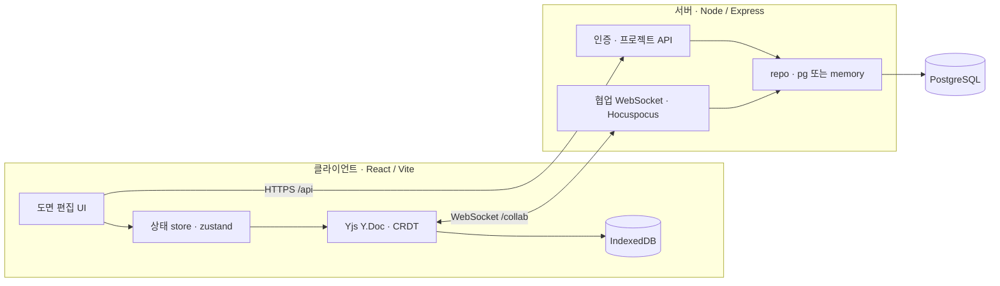
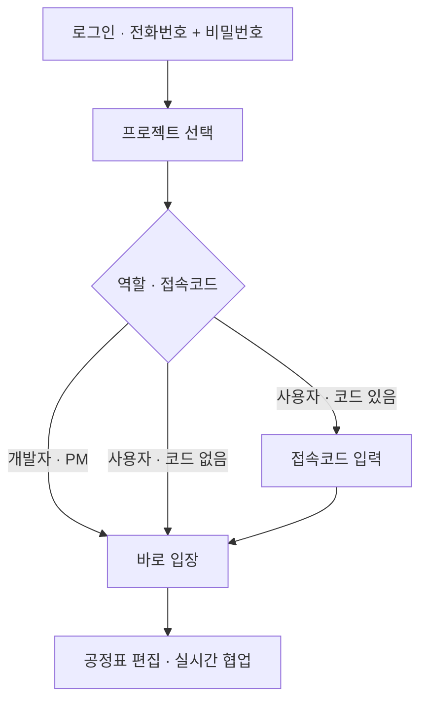

# Sequence

<p align="center">
  
</p>

> ⚠️ **위 GIF 은 2026-08-28 자로, 현재 화면과 다릅니다.** 진입 화면(로그인 · 사용자 등록 ·
> 프로젝트 선택)은 2026-09-12 ~ 09-14 에 전면 재디자인됐습니다. 재녹화 후 교체 예정.

**토목 설계·시공 공정표(예정공정표 · 마일스톤) 관리 프로그램**

Sequence 는 토목 전 분야(도로·교량·터널·하천·상하수도·항만·철도·단지·지반·수자원/댐 등)의
**공정표를 그리고, 일정을 계산하고, 도면으로 출력**하는 웹 애플리케이션입니다. 시설물 유형을
고르면 그 유형의 표준 공종·공정 프리셋으로 공정표가 세팅되고, 막대를 끌어 일정을 잡으면
선후행(CPM)·주공정·전체 공기가 실시간으로 계산됩니다.

---

## 주요 기능

- **전사공통 시설물 프리셋** — 11개 분야 43종(도로·공항 / 교량 / 터널 / 하천·방재 / 상수도 /
  하수도 / 항만·해안 / 철도·궤도 / 단지·부지 / 지반·기초 / 환경·정화 / 수자원·댐) 각각의 표준
  시공 공정표(공종·공정·마일스톤) 템플릿.
- **새 도면 마법사** — 도면 유형(타당성 / 기본설계 / 실시설계 / 시공)과 시설물 유형을
  검색·선택하고, 시작 전 **공정표 샘플(총 공기·공종·마일스톤)** 을 미리 봅니다.
- **일정 엔진(CPM)** — 선후행(FS/SS/FF/SF·지연) 연결, 주공정(Critical Path)·여유(Float)
  자동 계산, 연쇄 자동 이동·일정 정렬·재계산.
- **예정공정표 ↔ 마일스톤 연동** — 설계 단계 사업은 예정공정표와 시공 마일스톤 시트를 함께 관리.
- **우기 음영**, 연도/월 구분선, WBS(공종·세부공종) 좌측 라벨, 자유로운 막대 이동(날짜 제약 없음).
- **실시간 협업** — 같은 프로젝트에 동시 접속 시 다른 참여자의 커서·선택 위치가 이름·역할
  (관리자/사용자) 배지로 표시(Yjs/CRDT 기반).
- **시트별 도면 제목** — 한 사업의 예정공정표와 시공 마일스톤이 **서로 다른 제목**을 답니다.
  우측 `도면·프로젝트` 탭에서 정하고, 비우면 사업명으로 그립니다.
- **AI 검토 라운드트립** — 공정표를 `[AI검토] …md` 로 내보내 외부 LLM 에 검토시키고, 돌아온
  검토본을 다시 취입해 **검증된 기간 변경만 단일 커밋으로** 반영합니다(ADR-003). 반영하지 못한
  항목은 사유와 함께 남깁니다 — 조용히 넘어가지 않습니다.
- **공기 적정성 검증** — 법정 산정식(준비기간·정리기간·법정공휴일·기상일수)으로 총공기를 산정해
  현재 공정표와 대조하고 `적정 / 과소 / 과다 / 판정불가` 로 판정합니다.
- **내역서(BoQ) · 사내 일정표 취입** — 엑셀/CSV 의 물량·단위·공종코드, 그리고 외부 일정표의
  공종·공정·선후행을 취입합니다. 매핑하지 못한 행은 **반영하지 않고** 사유를 보고합니다.
- **건설사업관리 모듈 14종** — 8개 묶음(개요 / 공정 / 사업비 / 자원 / 품질·안전 / 문서·계약 /
  준공 / 관리)으로 좌측 레일에 배치됩니다.
  - **대시보드** — 사업 전체 KPI 총괄.
  - **진척·실적** — 실적 입력과 **EVM**(PV/EV/AC·SPI/CPI) 대시보드.
  - **프로젝트 예산 · 공사 사업비 · 인력·장비 · 품질·검측 · 안전관리 · 문서·도면 · 인허가 ·
    시운전 · 리스크·이슈** — 기록형 모듈. 각 레코드를 **공정표의 특정 공정에 앵커**로 묶어,
    공정과 관리 기록이 서로를 가리킵니다.
  - **변경이력·확정본** — 누가·언제·왜 바꿨는지의 감사기록과 확정본(baseline) 박제·비교.
  - **보고서** — 위 기록을 자동 집계해 출력.
- **화면 접기** — 좌측 모듈 레일(«/»)과 편집 화면의 좌·우 패널(보기 막대의 `☰ 공종 구성` /
  `⚙ 속성` 칩)을 접어 도면 영역을 넓힙니다. 1600px 화면에서 셋을 모두 접으면 도면이
  **850 → 1544px** 로 늘어납니다. 접힘 상태는 기기별로 기억합니다.
- **본부(조직 단위) · 권한(RBAC)** — 11개 본부(경영전략/물환경/수자원/국토개발/철도/도로/플랜트/
  CM/해외사업/사업개발실/안전품질관리실, 각 본부 심볼 포함). 프로젝트는 한 본부에 속하며 **같은
  본부만** 조회/입장 가능(개발자는 전체).
  - **개발자** — 전체 본부·프로젝트 관리(생성/삭제/활성·비활성). 대시보드는 **왼쪽 본부 목록에서
    본부를 클릭**해야 그 본부의 프로젝트가 보입니다.
  - **관리자(PM)** — 소속 본부의 모든 프로젝트 입장 가능(담당은 편집, 담당 아니면 조회 전용).
  - **사용자** — 소속 본부 프로젝트를 목록에서 보되, 배정된 프로젝트만 입장·편집.
- **셀프 등록 · 비밀번호 관리** — 로그인 화면 ‘사용자 등록’에서 역할(관리자/사용자)·본부·이름·
  전화번호(ID)·비밀번호로 가입. 비밀번호는 **8~12자, 영문·숫자·특수기호(!@#$%^&\*) 중 2종 이상**.
  사용자는 즉시 로그인, 관리자는 개발자 승인 후 로그인(개발자 대시보드·관리자 도구에 **요청 시각**과
  함께 승인 대기 표시). 로그인 5회 실패 시 **비밀번호 초기화 요청**(관리자에게 전달 → 관리자가 새
  비밀번호를 직접 지정), 로그인 후 **본인 비밀번호 변경** 가능. 구 정책(4자리) 계정은 다음 로그인
  때 새 비밀번호로 **변경 강제**.
- **참여 인원 관리** — 프로젝트별로 **본부를 선택하면 소속 인원이 체크박스 목록**으로 나오고,
  여러 명을 **한 번에 추가**(인원별로 관리자/사용자 권한 지정). 개발자·PM이 관리.
- **도면 출력** — A4~A0, 가로/세로, SVG · PNG · JPG · PDF · DXF, DPI 조절, 용지 맞춤.
- **동적 로그인 배경** — 마우스에 반응하는 패럴랙스 모션 배경.

---

## 기술 스택

| 영역 | 스택 |
|------|------|
| Client | React 18 · TypeScript · Vite · Zustand · Yjs(+y-indexeddb) · jsPDF |
| Server | Node.js · Express · Hocuspocus(WebSocket) · PostgreSQL(또는 파일 기반 메모리 저장소) |
| 협업/영속 | CRDT(Y.Doc) — room = projectId, IndexedDB(로컬) + 서버 영속 |
| 품질 | Biome(lint · format) |

요구 런타임: **Node.js ≥ 24 < 25**, **npm ≥ 11**.

---

## 아키텍처



## 접속 흐름



---

## 교육 · 지원

사용자용 문서는 모두 `docs/` 에 있습니다. 아래 표의 **상태** 열을 먼저 보십시오 —
`제안` 문서는 아직 확정되지 않았고, 사람·일정·목표치는 `⬜` 로 비워 둔 채 배포 시 채웁니다.

| 문서 | 상태 | 내용 |
|---|---|---|
| [접속 및 사용자 등록 안내](docs/Sequence_접속_및_사용자등록_안내.md) | **운영 중** | 접속 주소 · 셀프 등록 · 로그인 · 비밀번호 정책 · 본부 목록 · **문의 경로** |
| [15분 교육 안내](docs/Sequence_15분_교육안내.md) | 제안 | 처음 1회 따라하기 — 접속 → 일정 변경 → 진척 입력 → PDF 출력 |
| [본부별 업무 예제](docs/Sequence_본부별_업무예제.md) | 제안 | 11개 본부 각 1건. 서버가 심는 `[샘플] …` 프로젝트를 그대로 사용 |
| [지원 체계 및 도입 효과 측정](docs/Sequence_지원체계_및_도입효과_측정.md) | 제안 | 본부 대표 사용자 · 문의 처리 절차 · **시간절감/재사용/중복입력 중심 지표** · 성능·번들 실측 기록 |

앱 안에서는 상단 **🛟 문의** → **📋 진단 정보 복사** 로 진단 정보(앱 버전 · 배포 형태 ·
화면 크기 · 현재 모듈 · 공정/연결 수 · 최근 오류)를 복사해 담당자에게 붙여넣어 전달합니다.
**전화번호(아이디)·비밀번호는 포함되지 않고, 앱이 자동으로 보내지도 않습니다.**

효과 지표는 **로그인 횟수 같은 자동 카운트를 쓰지 않습니다** — 개인 감시가 아니라
업무 시간 절감·재사용·중복 입력 감소를 봅니다.

---

## 작은 화면 · 성능 측정

- **넓은 화면** — 모듈 레일은 «/» 로 아이콘 전용(150→56px)이 되고, 좌·우 패널은 보기 막대의
  **`☰ 공종 구성` / `⚙ 속성`** 칩으로 접힙니다. 레일을 통째로 감추지 않는 것은 모듈 전환이
  거기서만 되기 때문입니다 — 접어도 한 번 클릭으로 이동할 수 있어야 합니다.
- **좁은 화면(≤1100px)** — 레일이 자동으로 아이콘 전용이 되고, 좌·우 패널은 3단에서 빠져
  **서랍(☰ 공종 구성 / ⚙ 속성)** 으로 도면 **위에 겹쳐** 열립니다(도면 폭 유지).
  **휴대전화(≤760px)** 는 1차 범위를 **조회 · 검토 · 진척 입력**(대시보드 · 공정관리 ·
  진척·실적)으로 한정합니다.
- **측정 스크립트** — 코드 분할은 *재고 나서* 판단합니다.

  ```bash
  npm --prefix client run smoke:perf                       # 100/500/1000공정 계산 p50·p95
  npm --prefix client run build && npm --prefix client run bundle:report   # 청크 raw/gzip + 예산 게이트
  ```

  기준선과 판단 기준: [지원 체계 및 도입 효과 측정 §4](docs/Sequence_지원체계_및_도입효과_측정.md)

---

## 프로젝트 구조

```
Sequence/
├─ client/            # React + Vite 프런트엔드
│  ├─ src/
│  │  ├─ components/  # 차트·도면·다이얼로그·인증 UI·건설사업관리 모듈
│  │  ├─ data/        # 시설물 유형·공정표 프리셋(facilities, civilFacilities, templates, modules)
│  │  ├─ engine/      # 일정(CPM)·레이아웃·라우팅·날짜·공기 적정성·앵커
│  │  ├─ export/      # SVG/PNG/PDF/DXF 출력 · AI 검토 요청서(.md)
│  │  └─ state/       # store(zustand) · crdt · collaboration · auth
│  ├─ scripts/        # 스모크 테스트(tsx) · 단일 HTML 빌드 · 매뉴얼 생성
│  └─ public/         # 폰트·PWA·프리셋 애셋
├─ server/            # Express + Hocuspocus 협업/인증 서버
│  ├─ src/{auth,collab,llm,notify}/
│  ├─ scripts/        # 서버 스모크(auth·documents·collab·works·llm)
│  └─ db/schema.sql
├─ docs/              # 사용자 문서 · ADR · 검토보고서
├─ render.yaml        # render.com Blueprint(배포 설정)
└─ package.json       # 워크스페이스 스크립트(concurrently)
```

---

## 개발

```bash
npm install          # 루트 + client + server 의존성 설치(postinstall)
npm run dev          # 서버 + 클라이언트 동시 실행(concurrently)
npm run build        # 클라이언트 프로덕션 빌드(tsc --noEmit && vite build)
npm run lint         # Biome 린트
npm run check:fix    # Biome 린트+포맷 자동수정
```

개별 실행:

```bash
npm run dev:client   # Vite 개발 서버만
npm run dev:server   # 협업/인증 서버만
```

### 사내망(LAN) 실행

`start-lan.bat` 로 LAN 접속용 서버를 기동합니다. 서버 대상 배포(기본 빌드)에서는 클라이언트가
`/api/health` 를 **최대 3회(1.5s→2.5s→4.0s) 재시도**하고, 그래도 응답이 없으면
**‘서버에 연결할 수 없습니다 — 다시 시도 / 오프라인으로 계속’** 화면을 띄웁니다. 서버가 잠시
느리다는 이유로 조용히 로컬 모드로 떨어지지 않습니다. ‘오프라인으로 계속’을 고르면 그 선택을
브라우저에 기억(`sequence:offline-ack`)하고, 편집 화면 하단에 **⚠ 서버 미연결 — 로컬 모드** 배지를
상시 노출해 로컬 작성본을 협업 프로젝트로 착각하지 않게 합니다.

### 단일 HTML 배포본

```bash
npm --prefix client run build:single   # → Sequence.html (오프라인 단독 실행 파일)
```

`SINGLE=1` 빌드는 `__SEQUENCE_DEPLOY__='standalone'` 로 컴파일되어 서버 프로브를 아예 하지 않고,
첫 화면부터 **💾 오프라인 단독 실행본 — 이 PC에만 저장됩니다** 배지를 노출합니다.

### 저장 상태 표시 · 서버 버전 복구

- 상단바 저장 칩은 **연결 상태가 아니라 실제 영속 확정**으로 판정합니다. 서버가 문서를 기록한 뒤
  방에 보내는 `sequence:persisted` 확정 메시지를 받아야만 `서버 동기화 완료 · HH:MM` 이 되고,
  미전송 변경이 있거나 확정이 마지막 편집보다 오래됐으면 `전송 대기…` 로 남습니다.
  (`연결 끊김` / `동기화 오류` / 협업 방 밖이면 `로컬만 저장`.) 파일 백업(.json)은 별도 칩입니다.
- 서버는 CRDT 영속 시점마다 **프로젝트 ID 폴더**(`HN_AUTOSAVE_DIR`, 기본 `C:\ProgramData\Sequence`)에
  버전 스냅샷을 남깁니다. 개수·간격은 `HN_AUTOSAVE_KEEP`(기본 20) · `HN_AUTOSAVE_INTERVAL_MS`
  (기본 600000) 로 조정합니다. 저장 칩 → **⏱ 서버 버전에서 복구…** 에서 목록·미리보기 후
  확인을 거쳐 되돌립니다(자동 복구 없음).
  옛 임시저장은 파일명을 *프로젝트 이름*으로 잡아 동명 프로젝트끼리 서로를 덮어썼는데, ID 기준으로
  바뀌며 이 충돌이 사라졌습니다(`GET /api/autosave`·`/api/autosave/file/:name` 은 기존 파일 복구용으로만 유지).

---

## 배포 / 서버 설정

- **DB** — 운영은 PostgreSQL(`AUTH_BACKEND=pg`, `DATABASE_URL`). 스키마: `server/db/schema.sql`.
  파일 기반 메모리 저장소로도 동작(소규모/사내).
- **초기 계정** — 사용자가 하나도 없으면 환경변수(`AUTH_BOOTSTRAP_USER` /
  `AUTH_BOOTSTRAP_PASSWORD`, 기본 `admin` / `Sequence1!`)로 개발자 계정을 시드합니다.
  운영에선 `AUTH_BOOTSTRAP_PASSWORD`를 반드시 재설정하세요.
- **권한** — 개발자(전체) · PM(담당 프로젝트) · 사용자(부여받은 프로젝트).
- **승인·초기화 알림(옵션)** — 계정 신청·비밀번호 초기화 요청을 **네이버웍스(NAVER WORKS) Bot**으로
  운영자에게 DM 발송(`WORKS_*` 환경변수 설정 시, `server/.env.example` 참고). 미설정이면 인앱 표시만.

### render.com (클라우드 상시 구동)

설정은 저장소 `render.yaml`(Blueprint)에 있습니다. **"New > Blueprint" 로 만든 서비스에만**
적용되므로, 대시보드에서 손으로 만든 서비스는 아래를 직접 넣어야 합니다.

| 항목 | 값 |
|---|---|
| Build Command | `npm install && npm run build` |
| Start Command | `npm --prefix server start` |
| `NODE_VERSION` | `24` |
| `AUTH_JWT_SECRET` | 16자 이상 (**미설정 시 운영 모드에서 기동 거부**) |
| `HN_DATA_DIR` · `HN_AUTOSAVE_DIR` | 영구 디스크 경로 (`/var/data`, `/var/data/autosave`) |
| `COLLAB_ALLOWED_ORIGINS` | 서비스 URL (미설정 시 협업 WebSocket 차단) |

- 루트의 `npm start` 는 `npm run dev`(vite 개발 서버)라 **배포에 쓰면 안 됩니다** —
  `localhost` 에만 바인딩돼 플랫폼의 `0.0.0.0` 포트 스캔이 실패합니다.
- 프로젝트·공정표·CRDT ydoc·**계정**이 모두 파일 기반이라 영구 디스크 없이는 재배포마다
  초기화됩니다. Free 플랜은 디스크를 붙일 수 없고 15분 유휴 시 sleep 됩니다.
- `HN_AUTOSAVE_DIR` 을 비우면 리눅스에서는 `ProgramData` 가 없어 `os.homedir()` 밑
  휘발성 경로로 떨어져 **버전 스냅샷이 조용히 사라집니다.**

### 전사 배포 · 계정 일괄 등록

1. **명부 업로드** — 관리자 도구에서 사내 명부 엑셀(`전화번호` · `이름` · `그룹` 열)을 올리면
   전 직원 계정이 한 번에 생성됩니다. **초기 비밀번호 = 전화번호 뒤 4자리**(현 비밀번호 정책 미충족이라
   각자 **최초 로그인 시 새 비밀번호로 변경**하게 됩니다).
   (또는 `username · name · role · password` 열의 일반 CSV/엑셀도 지원.)
2. **로그인** — 아이디 = 전화번호(010-…), 비밀번호 = 뒤 4자리로 각자 접속.
3. **테스트 프로젝트** — 접속코드 없이 만든 프로젝트에 인원을 배정하면, 배정된 관리자·
   사용자는 코드 없이 바로 입장해 함께 테스트할 수 있습니다.

---

## 브랜치 · 원격

작업 브랜치는 **`feat/ai-review-roundtrip`** 하나입니다. 이름은 처음 판 기능(AI 검토
라운드트립)에서 왔지만, 지금은 그 이후의 모든 작업이 쌓인 사실상의 트렁크입니다
(`Sequence` 이후 38커밋). `Sequence` · `main` 은 옛 tip 에 머물러 있어 **최신이 아닙니다.**

| 원격 | 주소 | 역할 |
|---|---|---|
| `origin` | `gitea.hmac.kr/saman/HydroNET` | 정본. 기본 브랜치 `Sequence` |
| `github` | `github.com/hjlee624/HydroNet` (PRIVATE) | 미러. 기본 브랜치 `feat/ai-review-roundtrip` = render 배포원 |

커밋 후에는 **두 원격의 `feat/ai-review-roundtrip` 을 같은 tip 으로** 맞춥니다.

```bash
git push origin feat/ai-review-roundtrip && git push github feat/ai-review-roundtrip
```
