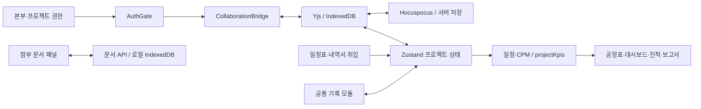

# Sequence 전체 검토 및 최적화

- 검토일: 2026-09-10
- 대상: http://10.12.29.180:4020/ 및 현재 작업 트리
- 원칙: 기존 미커밋 작업·운영 데이터를 보존하고 재현된 오류부터 회귀시험 후 수정한다. 새 의존성은 추가하지 않는다.

## 기능과 화면 구성

프로젝트 선택은 본부·권한·검색·즐겨찾기 중심이다. 프로젝트 내부는 대시보드, 공정관리, 진척·실적, 예산, 공사 사업비, 인력·장비, 품질·검측, 안전, 문서·도면, 인허가, 시운전, 리스크, 변경이력, 보고서의 15개 모듈로 구성된다. 전용 공정 편집기와 공통 기록 테이블을 혼합한 구조는 작은 구현으로 업무 범위를 넓히는 장점이 있다. 다만 기록 CRUD와 전문적인 자동 분석 기능의 완성도는 구분해야 한다. `modules.ts`의 계획 목록은 구현 보장이 아니다.

## 구조와 유기적 연결

공정표와 관리 기록은 프로젝트 상태를 공유한다. 공사 사업비 취입은 수량·단가와 공정으로 연결되고 KPI는 공통 `projectKpis`에서 파생된다. 첨부 문서는 별도 저장 경로이므로 CRDT 기록 저장 완료가 첨부 문서 저장 완료를 뜻하지 않는다. 품질·인허가 등의 공정명은 자유 텍스트가 많아 공정 ID 기반 선행조건 강제와 동일하지 않다.

## 확인된 문제와 반영 계획

| 우선순위 | 근거 | 문제 | 수정·검증 |
|---|---|---|---|
| P1 | `server/src/collab/auth.js` | 비활성 프로젝트의 기존 단수명 티켓으로 재접속 가능 | 현재 프로젝트 active 상태 재검사, 서명 토큰 회귀시험 |
| P1 | `state/store.ts`, `state/scheduleImport.ts` | 일정 재취입의 공종 이동 누락, 연결 지연일 갱신 누락 | ID 유지 upsert, 새 공종 생성·변경 미리보기, 회귀시험 |
| P1 | `state/scheduleImport.ts` | 종료일이 시작 전날이면 기간 0 마일스톤으로 잘못 허용 | 날짜 역전 별도 검사, 명시적 기간 0 보존 |
| P2 | `DocumentPanel.tsx` | 모듈 전환 시 이전 분류·늦은 응답 잔존, 오류 미처리 | 프로젝트/모듈별 상태 분리, 취소·오류·재시도 처리 |
| P2 | 실제 인허가 화면 / `index.css` | 기록 영역 1180px와 첨부 영역 전체 폭의 정렬 불일치 | 같은 콘텐츠 폭, 좁은 화면 줄바꿈·문서 메타정보 유지 |
| P2 | `RecordModule.tsx` | 서버 미연결이어도 동기화를 단정하는 안내, 입력 접근성 이름 부족 | 실제 저장 상태 칩 재사용, 열·행 이름 제공 |
| P1 | `ChartCanvas.tsx`, `TopBar.tsx` | 최소 25% 배율로는 긴 예정공정표·마일스톤의 전체 범위를 한 화면에서 확인할 수 없음 | 가로·세로 동시 계산 `전체 맞춤`, 최소 2% 배율, 마운트·실화면 검증 |

## 디자인 판단

기존 cream·orange 테마와 공정 중심 정보 구조를 유지한다. 대시보드의 1600px 그리드는 1920px 화면에서 KPI·경보를 비교하기 적합하다. 기록형 화면은 1180px의 동일한 기준선에 제목·표·첨부 문서를 맞춘다. 첨부 목록은 모바일에서도 분류·개정·상태를 감추지 않는다. 새 디자인 시스템 대신 기존 토큰과 버튼을 사용한다. 세부 계약은 루트 `DESIGN.md`를 따른다.

## 모듈별 검토 범위와 판단

| 화면 | 현재 연결/구조 | 판단과 최적화 방향 |
|---|---|---|
| 로그인·프로젝트 선택 | 계정 → 본부 → 프로젝트 → 협업 방 | 본부 검색·권한 분리 적절. 재시작 후 로그인 유지 운영 설정은 별도 점검 필요 |
| 대시보드 | 일정·진척·예산·경보의 공통 KPI | 정보 위계 유지. 비어 있는 KPI는 입력 모듈로 안내 |
| 공정관리 | 시트·공종·공정·연결·CPM·출력 | 중심 기능. 일정 취입 공종/지연일/역전 날짜 결함 수정 |
| 진척·실적 | 공정별 실적 → 기간 가중 집계 → 대시보드·보고서 | 실제 입력값과 계획을 비교. 가중 방식은 문구로 명시 |
| 프로젝트 예산 | 예산·집행·잔액 → EVM | 원가 산식과 공사 사업비 단위(천원/원)를 유지 |
| 공사 사업비 | 수량×단가, 내역서 취입 → 공정 정보 | 기존 취입 작업 보존. 문서 미리보기와 취입 동선 유지 |
| 인력·장비 | 공정명·일자·수량 기록 | 투입 기록과 부하 최적화는 구분; 자동 부하 분석은 후속 |
| 품질·검측 | WIR/NCR/체크리스트·상태 기록 | 기록·경보 활용 가능. 공정 ID 참조와 승인 흐름은 후속 |
| 안전관리 | 위험성·위치·일자·조치 기록 | 명확한 항목과 첨부 근거 유지. 위험도 자동 판정으로 과장 금지 |
| 문서·도면 | 문서 대장 + 별도 첨부 API | 분류/개정/상태 접근성·실패 안내 개선 |
| 인허가 | 신청·승인·기한·상태 기록 | 현재 공정 선행조건 강제는 아님. 문서 분류 전환 오류 개선 |
| 시운전 | 절차·시험·준공·하자 기록 | 결과와 근거 첨부 중심; 상세 검사 규칙은 후속 |
| 리스크·이슈 | 영향·가능성·담당·기한·상태 | 업무 대응 기록 중심. 정량 일정 영향 시뮬레이션과 구별 |
| 변경이력·확정본 | 변경 사유·기준선·버전·문서 근거 | 기존 이력 보존. 복구 권한의 개발자 예외 유지 |
| 보고서 | 프로젝트 공통 KPI·업무 기록 집계 | 기록 화면에서 보고서 바로가기를 추가해 입력→확인 연결 강화 |

실제 운영 브라우저에서는 프로젝트 목록·샘플 대시보드·인허가 화면을 직접 확인했다. 다른 모듈은 소스 구조와 자동 렌더/계산 시험을 근거로 검토했다. 모든 운영 계정·모든 파일 형식·모든 CRUD를 실서비스에서 수행했다는 의미는 아니다.

## 후속 최적화

1. 기록과 공정 연결을 자유 텍스트에서 선택적 taskId 참조로 확장: 삭제·시트 이동·취입 재매칭 정책과 데이터 마이그레이션을 함께 설계한다.
2. 인허가 승인과 공정 착수 제한, 자원 부하·품질 점검의 자동 분석은 업무 규칙 확정 후 추가한다. 현재 단순 기록 기능을 자동 제어 기능으로 설명하지 않는다.
3. 문서의 삭제·보존·개정 정책을 확정하고 프로젝트 삭제 후 첨부 보존 여부를 명시한다. 이번 작업에서 기존 문서를 일괄 삭제하지 않는다.
4. 성능은 기존 100/500/1000공정 smoke와 번들 예산을 기준으로 측정한다. 측정 없이 대규모 상태 분리나 새 라이브러리를 도입하지 않는다.
5. 로그인·관리자 변경·파일 업로드·다중 사용자 경쟁은 격리된 fixture로 검증한다. 운영 프로젝트의 내용은 수정하지 않는다.

## 검증 결과

| 검사 | 결과 |
|---|---|
| `npm --prefix client run build` | TypeScript + Vite 프로덕션 빌드 통과 |
| `npm --prefix client run smoke:schedule-import` | 244개 통과. 새 회귀시험은 수정 전 실패를 확인 |
| `node server/scripts/collab-active-smoke.mjs` | 활성→비활성 기존 티켓 거부→재활성 통과. 개발자의 비활성 프로젝트 복구 권한 보존 |
| `npm --prefix server run collab-smoke` | COLLAB SMOKE PASS. 동시 편집·권한 회수·저장 확정·버전·재시작 복원 검증 |
| `npm --prefix client run smoke:documents` | 분류 초기화, 늦은 이전 모듈 응답 격리, 로딩·실패·재시도, 업로드 버튼·읽기전용 통과 |
| `npm --prefix client run mount-test` | MOUNT OK. 대시보드·기록·진척·보고서·편집기·모달·반응형 회귀 통과. jsdom canvas 미구현 경고 1건 |
| 공정표 전체 맞춤 | 큰 시트 자동 축소, 가로·세로 캔버스 내부 수용, 2% 하한 회귀시험 통과. 예정공정표 41%·마일스톤 64%에서 실화면 전체 범위 확인 |
| `npm --prefix client run smoke` | ALL PASS. CPM·연쇄 변경·레이아웃·출력 점검·실행취소 |
| `npm --prefix client run smoke:perf` | 1000공정 p95 3.4ms, 기존 예산 120ms 이내. 순수 계산 시험이며 브라우저 프레임 시간은 아님 |
| `npm --prefix client run bundle:report` | 진입 JS gzip 약 379KB, 예산 430080B 이내 |
| 시각 검토 | 1920px / 1000px / 390px. 동일 기준선, 업로드 폼 줄바꿈, 모바일 안내의 세로 글자 나열 개선 |
| 변경 범위 집중 린트 | DocumentPanel, ModuleRail, 문서 회귀시험, 협업 인증/회귀시험 통과 |
| 전체 `npm run lint` | 미통과. 실행 시 197 errors / 75 warnings; 기존 security 정규식·favicon 접근성 등 포함, 잘못된 `src` 경로로 도구 I/O 오류도 존재. 전체 정리 완료를 주장하지 않음 |
| `git diff --check` | 통과 |

### 반영 확인 및 한계

4020 서버는 `node --watch`로 실행 중이어서 서버 소스 변경을 자동 재시작했다. `/api/health`의 `ok:true`와 서비스가 내려주는 HTML이 `client/dist/index.html`과 일치함을 확인했다. 임의의 계정 변경이나 운영 프로젝트 데이터 변경은 하지 않았다.

재시작 후 운영 브라우저는 로그인 화면으로 돌아왔다. 따라서 수정 후 내부 화면은 같은 소스의 격리된 오프라인 샘플 빌드를 127.0.0.1:4031에서 검증했다. 운영 계정 재로그인 후 내부 화면의 최종 수동 확인은 남아 있다. 세션 무효화의 정확한 원인은 비밀 설정을 열람하지 않았으므로 단정하지 않는다.

추가 확인 사항: 서버 문서 업로드의 유효성 오류가 공통 asyncRoute에서 일반 500으로 바뀌는 구조, 프로젝트 삭제와 별도 문서 보존 정책은 후속 개선 대상으로 남겼다. 저장소 전체 린트 오류 해소 및 장기 기능 확장은 이번 확인 결함 수정과 구분한다.
