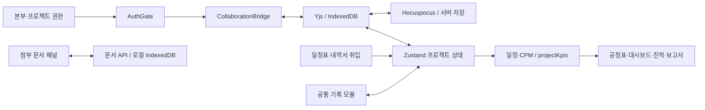

# Sequence 전체 검토 및 최적화

- 검토일: 2026-09-10
- 대상: http://10.12.29.180:4020/ 및 현재 작업 트리
- 원칙: 기존 미커밋 작업·운영 데이터를 보존하고 재현된 오류부터 회귀시험 후 수정한다. 새 의존성은 추가하지 않는다.

## 기능과 화면 구성

프로젝트 선택은 본부·권한·검색·즐겨찾기 중심이다. 프로젝트 내부는 대시보드, 공정관리, 진척·실적, 예산, 공사 사업비, 인력·장비, 품질·검측, 안전, 문서·도면, 인허가, 시운전, 리스크, 변경이력, 보고서의 15개 모듈로 구성된다. 전용 공정 편집기와 공통 기록 테이블을 혼합한 구조는 작은 구현으로 업무 범위를 넓히는 장점이 있다. 다만 기록 CRUD와 전문적인 자동 분석 기능의 완성도는 구분해야 한다. `modules.ts`의 계획 목록은 구현 보장이 아니다.

## 구조와 유기적 연결

공정표와 관리 기록은 프로젝트 상태를 공유한다. 공사 사업비 취입은 수량·단가와 공정으로 연결되고 KPI는 공통 `projectKpis`에서 파생된다. 첨부 문서는 별도 저장 경로이므로 CRDT 기록 저장 완료가 첨부 문서 저장 완료를 뜻하지 않는다. 품질·인허가 등의 공정명은 자유 텍스트가 많아 공정 ID 기반 선행조건 강제와 동일하지 않다.

## 확인된 문제와 반영 계획

| 우선순위 | 근거 | 문제 | 수정·검증 |
|---|---|---|---|
| P1 | `server/src/collab/auth.js` | 비활성 프로젝트의 기존 단수명 티켓으로 재접속 가능 | 현재 프로젝트 active 상태 재검사, 서명 토큰 회귀시험 |
| P1 | `state/store.ts`, `state/scheduleImport.ts` | 일정 재취입의 공종 이동 누락, 연결 지연일 갱신 누락 | ID 유지 upsert, 새 공종 생성·변경 미리보기, 회귀시험 |
| P1 | `state/scheduleImport.ts` | 종료일이 시작 전날이면 기간 0 마일스톤으로 잘못 허용 | 날짜 역전 별도 검사, 명시적 기간 0 보존 |
| P2 | `DocumentPanel.tsx` | 모듈 전환 시 이전 분류·늦은 응답 잔존, 오류 미처리 | 프로젝트/모듈별 상태 분리, 취소·오류·재시도 처리 |
| P2 | `documents.js`, `index.js` | 빈 파일·8MB 초과·잘못된 모듈 입력이 모두 일반 500으로 응답해 사용자가 원인을 알 수 없음 | 문서 입력 오류 타입만 400/413 및 구체적 안내로 변환. 예기치 않은 저장 오류는 일반 500 유지. 격리 HTTP 회귀시험 통과 |
| P2 | 실제 인허가 화면 / `index.css` | 기록 영역 1180px와 첨부 영역 전체 폭의 정렬 불일치 | 같은 콘텐츠 폭, 좁은 화면 줄바꿈·문서 메타정보 유지 |
| P2 | `RecordModule.tsx` | 서버 미연결이어도 동기화를 단정하는 안내, 입력 접근성 이름 부족 | 실제 저장 상태 칩 재사용, 열·행 이름 제공 |
| P1 | `ChartCanvas.tsx`, `TopBar.tsx` | 최소 25% 배율로는 긴 예정공정표·마일스톤의 전체 범위를 한 화면에서 확인할 수 없음 | 가로·세로 동시 계산 `전체 맞춤`, 최소 2% 배율, 마운트·실화면 검증 |
| P1 | `Inspector.tsx`, `ChartSvg.tsx` | 전체표 확인을 위해 축소하면 공정 막대·마일스톤이 너무 얇아 선택과 수정이 어려움 | 용지와 독립된 월 폭 조절, 저배율 최소 표시·포인터 영역, 마운트·실화면 클릭 검증 |
| P1 | `ChartCanvas.tsx`, `ChartSvg.tsx`, `exporter.ts` | 전체 맞춤 3%에서 공사명·WBS·연월·막대명·공사일수가 1~2px로 축소되어 판독 불가 | 부족한 축의 밀도 확장, 역할별 최소 화면 글자 크기와 짧은 막대 최소 폭 보장, 출력 시 원래 도면 크기 복원 |
| P1 | `SaveStatusChip.tsx`, `index.css` | 편집할 때마다 동기화 문구 길이가 바뀌어 상단 도구와 작업 화면이 좌우로 흔들림 | 서버 동기화·파일 백업 상태 칸의 폭과 숫자 폭을 고정 |
| P1 | `layout.ts`, `ChartSvg.tsx`, `ChartCanvas.tsx` | 좌측 WBS 문구가 저배율에서 시간축으로 침범하고 세부공정이 상위 공정 한 줄에 강제 고정됨 | 중복 좌측 헤더 제거, WBS 라벨 열 클리핑, 같은 상위 공정 블록 내 세부공정 다중 행 드래그 허용 |
| P1 | `ChartSvg.tsx`, `Inspector.tsx`, `exporter.ts` | 전체 맞춤에서 연결선·화살촉·선택 영역이 1px 미만으로 축소되어 보이지 않고 속성 편집 진입도 어려움 | 막대 높이에 비례한 화면 최소 두께, 6px 화살촉·14px 선택 영역 보장, 연결 속성 목록 선택 제공, 출력 시 원래 도면 두께 복원 |
| P1 | `TopBar.tsx`, `ModuleRail.tsx`, `index.css` | 상단 브랜드와 긴 상태 문구 때문에 도구막대에 가로 스크롤이 생기고 프로젝트명이 밀림 | 브랜드를 좌측 모듈 레일에 `Sequence`/`건설 공정표` 두 줄로 이동, 프로젝트명을 상단 첫 항목으로 배치, 상단 가로 스크롤 제거 |
| P1 | `Inspector.tsx`, `taskColor.ts`, `ChartSvg.tsx` | 막대색이 공종에 묶여 공정과 세부공정의 실제 작업 묶음을 구분하기 어려움 | 선택 공정의 최상위 공정과 모든 세부공정에 같은 색을 적용하고 차트·DUMMY 음영도 공정 묶음 색을 사용 |
| P1 | `preflight.ts`, `paper.ts`, `exporter.ts` | 긴 기간·많은 작업을 A3 한 장에 강제 축소하면 공사명·공정명·기간·연월이 인쇄물에서 판독 불가 | 전체 출력에서 화면용 표시기간을 제거하고, 최소 6pt를 지킬 수 없을 때 선택 용지 크기를 유지한 채 PDF를 자동 분할하며 각 장에 좌측 WBS·연월 헤더·제목을 반복 |
| P2 | `Inspector.tsx`, `layout.ts` | 텍스트 크기 입력 상한 120px와 내부 글자 배율 상한 때문에 사용자가 필요한 출력 크기를 지정하지 못함 | 양수 입력만 검증하고 임의 상한 제거, 도면 배율에 따른 글자 확대 상한 제거 |
| P1 | `labelLayout.ts`, `ChartSvg.tsx`, `layout.ts` | 큰 공정명이 막대를 가로지르고 같은 행의 인접 공정명이 서로 겹쳐 화면·PDF에서 식별 불가 | 글자 크기 비례 상단 여백, 행 높이 확보, 같은 행 라벨의 순서 보존 좌우 분산을 공통 SVG 렌더에 적용 |
| P1 | `layout.ts`, `ChartCanvas.tsx`, `Inspector.tsx` | 용지 맞춤이 캔버스 폭으로 글자 배율을 다시 계산해 월 폭 12,175px·글자 88,430%·화면 2%로 폭주 | 자동 맞춤을 판독 범위(월 8~120px·행 32~240px·글자 50~300%)로 제한하고 범위 외 값은 기본 밀도로 복구. 용지 비율 계산과 화면 전체 줌을 분리해 서로 덮어쓰지 않게 함 |
| P1 | `theme.ts`, `ChartSvg.tsx`, `exporter.ts` | 저배율에서 화면 글자를 키우면 위 행의 공사일수가 아래 행의 공정명에 가려짐(48% 배율 실측 9~12px, 3건). layout 은 확대 전 크기로 행 높이를 잡는데 렌더는 키운 크기로 그림 | 행 높이 예산 안에서 두 라벨 크기를 정하는 `resolveRowLabelSizes()` 도입. 공정명 우선, 자리가 없으면 공사일수는 화면에서만 감추고 출력물에서 복원. 브라우저 실측 겹침 0건·공정명 8.5px 유지, 부정 대조군 포함 회귀시험 추가 |

## 디자인 판단

기존 cream·orange 테마와 공정 중심 정보 구조를 유지한다. 대시보드의 1600px 그리드는 1920px 화면에서 KPI·경보를 비교하기 적합하다. 기록형 화면은 1180px의 동일한 기준선에 제목·표·첨부 문서를 맞춘다. 첨부 목록은 모바일에서도 분류·개정·상태를 감추지 않는다. 새 디자인 시스템 대신 기존 토큰과 버튼을 사용한다. 세부 계약은 루트 `DESIGN.md`를 따른다.

## 모듈별 검토 범위와 판단

| 화면 | 현재 연결/구조 | 판단과 최적화 방향 |
|---|---|---|
| 로그인·프로젝트 선택 | 계정 → 본부 → 프로젝트 → 협업 방 | 본부 검색·권한 분리 적절. 재시작 후 로그인 유지 운영 설정은 별도 점검 필요 |
| 대시보드 | 일정·진척·예산·경보의 공통 KPI | 정보 위계 유지. 비어 있는 KPI는 입력 모듈로 안내 |
| 공정관리 | 시트·공종·공정·연결·CPM·출력 | 중심 기능. 일정 취입 공종/지연일/역전 날짜 결함 수정 |
| 진척·실적 | 공정별 실적 → 기간 가중 집계 → 대시보드·보고서 | 실제 입력값과 계획을 비교. 가중 방식은 문구로 명시 |
| 프로젝트 예산 | 예산·집행·잔액 → EVM | 원가 산식과 공사 사업비 단위(천원/원)를 유지 |
| 공사 사업비 | 수량×단가, 내역서 취입 → 공정 정보 | 기존 취입 작업 보존. 문서 미리보기와 취입 동선 유지 |
| 인력·장비 | 공정명·일자·수량 기록 | 투입 기록과 부하 최적화는 구분; 자동 부하 분석은 후속 |
| 품질·검측 | WIR/NCR/체크리스트·상태 기록 | 기록·경보 활용 가능. 공정 ID 참조와 승인 흐름은 후속 |
| 안전관리 | 위험성·위치·일자·조치 기록 | 명확한 항목과 첨부 근거 유지. 위험도 자동 판정으로 과장 금지 |
| 문서·도면 | 문서 대장 + 별도 첨부 API | 분류/개정/상태 접근성·실패 안내 개선 |
| 인허가 | 신청·승인·기한·상태 기록 | 현재 공정 선행조건 강제는 아님. 문서 분류 전환 오류 개선 |
| 시운전 | 절차·시험·준공·하자 기록 | 결과와 근거 첨부 중심; 상세 검사 규칙은 후속 |
| 리스크·이슈 | 영향·가능성·담당·기한·상태 | 업무 대응 기록 중심. 정량 일정 영향 시뮬레이션과 구별 |
| 변경이력·확정본 | 변경 사유·기준선·버전·문서 근거 | 기존 이력 보존. 복구 권한의 개발자 예외 유지 |
| 보고서 | 프로젝트 공통 KPI·업무 기록 집계 | 기록 화면에서 보고서 바로가기를 추가해 입력→확인 연결 강화 |

실제 운영 브라우저에서는 프로젝트 목록·샘플 대시보드·인허가 화면을 직접 확인했다. 다른 모듈은 소스 구조와 자동 렌더/계산 시험을 근거로 검토했다. 모든 운영 계정·모든 파일 형식·모든 CRUD를 실서비스에서 수행했다는 의미는 아니다.

## 후속 최적화

1. 기록과 공정 연결을 자유 텍스트에서 선택적 taskId 참조로 확장: 삭제·시트 이동·취입 재매칭 정책과 데이터 마이그레이션을 함께 설계한다.
2. 인허가 승인과 공정 착수 제한, 자원 부하·품질 점검의 자동 분석은 업무 규칙 확정 후 추가한다. 현재 단순 기록 기능을 자동 제어 기능으로 설명하지 않는다.
3. 문서의 삭제·보존·개정 정책을 확정하고 프로젝트 삭제 후 첨부 보존 여부를 명시한다. 이번 작업에서 기존 문서를 일괄 삭제하지 않는다.
4. 성능은 기존 100/500/1000공정 smoke와 번들 예산을 기준으로 측정한다. 측정 없이 대규모 상태 분리나 새 라이브러리를 도입하지 않는다.
5. 로그인·관리자 변경·파일 업로드·다중 사용자 경쟁은 격리된 fixture로 검증한다. 운영 프로젝트의 내용은 수정하지 않는다.

## 검증 결과

| 검사 | 결과 |
|---|---|
| `npm --prefix client run build` | TypeScript + Vite 프로덕션 빌드 통과 |
| `npm --prefix client run smoke:schedule-import` | 244개 통과. 새 회귀시험은 수정 전 실패를 확인 |
| `node server/scripts/collab-active-smoke.mjs` | 활성→비활성 기존 티켓 거부→재활성 통과. 개발자의 비활성 프로젝트 복구 권한 보존 |
| `npm --prefix server run collab-smoke` | COLLAB SMOKE PASS. 동시 편집·권한 회수·저장 확정·버전·재시작 복원 검증 |
| `npm --prefix client run smoke:documents` | 분류 초기화, 늦은 이전 모듈 응답 격리, 로딩·실패·재시도, 업로드 버튼·읽기전용 통과 |
| `npm --prefix server run documents-smoke` | 수정 전 빈 파일 요청이 500으로 실패함을 확인. 수정 후 빈 파일·잘못된 모듈 400, 용량 초과 413, 잘못된 업로드 미저장, 정상 업로드·목록·다운로드·삭제, 저장 장애 500의 내부 경로 비노출 통과. 인증을 끈 임시 데이터 디렉터리의 HTTP 시험이며 권한 검증은 기존 협업 시험 범위 |
| `npm --prefix client run mount-test` | MOUNT OK. 대시보드·기록·진척·보고서·편집기·모달·반응형 회귀 통과. jsdom canvas 미구현 경고 1건 |
| 막대 주석 배치 | 큰 글자에서도 공정명 기준선이 막대 상단 여백을 지키고, 같은 행의 인접 공정명이 좌우로 분산되어 겹치지 않는 회귀시험 및 로컬 실화면 검토 통과 |
| 공정표 전체 맞춤 | 큰 시트 자동 축소, 가로·세로 캔버스 내부 수용, 2% 하한 회귀시험 통과. 예정공정표 41%·마일스톤 64%에서 실화면 전체 범위 확인 |
| 월 폭·저배율 편집 | 월 폭 8~600px 독립 조절, 용지 변경 시 편집 밀도 유지, 15% 배율 최소 막대 높이·확장 클릭 영역 회귀시험 통과. 실화면에서 월 폭 변경 후 얇은 공정 막대 선택 확인 |
| 전체 맞춤 판독성 | 가로·세로 밀도 균형 조정과 3% 저배율 공사명·공종·공정·연·월·막대명·공사일수의 역할별 최소 화면 크기, 짧은 막대 5px 폭 회귀시험 통과. 출력 SVG는 사용자 지정 원래 글자 크기로 복원 |
| 자동 맞춤 폭주 복구 | 월 폭 12,175px·글자 88,430%·화면 2% 상태를 주입해 월 폭 120px 이하·글자 300% 이하로 복구하고 화면 배율이 2% 위로 회복되는 마운트 회귀시험 통과 |
| `npm --prefix client run smoke` | ALL PASS. CPM·연쇄 변경·레이아웃·출력 점검·실행취소 |
| `npm --prefix client run smoke:export` | 공정 묶음 색상, 전체 범위의 화면 표시기간 무시, 최소 6pt PDF 자동 분할, 각 장의 좌측 WBS·상단 연월 헤더 반복 회귀시험 통과 |
| A3 PDF 출력 | 한 장 배치에서 6pt 이상이면 1장 유지. 그보다 작아지면 선택한 A3 규격으로 자동 분할하고 완료 메시지에 실제 장수 표시 |
| `npm --prefix client run smoke:perf` | 1000공정 p95 3.4ms, 기존 예산 120ms 이내. 순수 계산 시험이며 브라우저 프레임 시간은 아님 |
| `npm --prefix client run bundle:report` | 진입 JS gzip 약 379KB, 예산 430080B 이내 |
| 시각 검토 | 1920px / 1000px / 390px. 동일 기준선, 업로드 폼 줄바꿈, 모바일 안내의 세로 글자 나열 개선 |
| 변경 범위 집중 린트 | DocumentPanel, ModuleRail, 문서 회귀시험, 협업 인증/회귀시험 통과 |
| 전체 `npm run lint` | 미통과. 실행 시 197 errors / 75 warnings; 기존 security 정규식·favicon 접근성 등 포함, 잘못된 `src` 경로로 도구 I/O 오류도 존재. 전체 정리 완료를 주장하지 않음 |
| `git diff --check` | 통과 |

### 반영 확인 및 한계

#### 요구사항별 완료 감사 (2026-09-11)

| 원래 요구사항 | 현재 근거 | 판정 |
|---|---|---|
| 아키텍처·기능 간 연결 관계 검토와 Markdown 보고서 | 본 문서의 상태·협업·문서 저장 경로 모식도, 모듈별 연결/구조 표, 결함별 소스 위치 | 보고서 작성 및 코드 검토 완료 |
| 화면 폭 활용·버튼 배치·반응형·동기화 상태 안정성 개선 | DESIGN.md 계약, 공통 콘텐츠 폭·모듈 레일·고정 상태 칸, mount-test의 상단/서랍/모달 검증 | 구현 및 자동 검증 완료. 기존 시각 검토와 최신 운영 화면 검증을 구별해야 함 |
| 전체 맞춤·월 폭·막대/글자/연결선 판독·편집 | efc5c90의 폭주 복구, 3db5a0a의 라벨 배치, mount-test의 저배율 최소 크기·선택 영역·WBS 경계·복구 회귀 | 구현 및 자동 검증 완료. 실제 사연댐 데이터의 최종 화면 판독성 미검증 |
| 출력에서도 읽을 수 있는 공정표 | export smoke의 범위·최소 pt·PDF 분할·반복 헤더, 공통 SVG 라벨 배치 | 계산·구조 검증 완료. 최신 실제 PDF 페이지의 시각 검증 미완료 |
| 확인한 기능 연결 결함 수정 | 일정 취입 upsert·지연일, 문서 패널 상태 격리, 협업 활성 상태 검사, 92636bf 업로드 오류 분류 및 HTTP 회귀 | 문서에 열거한 결함 수정 완료. 미구현 신규 업무 자동화는 별도 후속 제안 |
| 변경 기록 및 Gitea 커밋·푸시 | feat/ai-review-roundtrip의 3db5a0a → efc5c90 → 92636bf | 푸시 완료 |

완료 판정을 막던 항목은 최신 실제 화면과 출력물의 시각 검증이었다. 2026-09-12 브라우저 도구로 **이 검증을 수행했고, 그 과정에서 자동 검사가 잡지 못한 라벨 겹침 결함을 찾아 수정했다**. 아래 `2026-09-12 시각 검증` 절 참조.

#### 2026-09-12 시각 검증 (브라우저 실측)

같은 소스의 격리된 오프라인 단일 빌드(`SINGLE=1`, 127.0.0.1:4031)를 1920×1080 뷰포트에서 구동하고, TBM 터널 프리셋(공정 50개·1,230일 — 저장소 프리셋 중 최장)으로 확인했다. 운영 계정·운영 데이터는 건드리지 않았다.

| 확인 항목 | 결과 |
|---|---|
| 첫 실행 안내·모듈 레일 브랜드·상단 프로젝트명 | 실제 화면에서 동작 확인. 상단 가로 스크롤 없음 |
| 전체 맞춤 | 48% 로 수렴(2~3% 폭주 재현 안 됨). 가로·세로 모두 캔버스 안에 수용 |
| 인접 공정명 겹침 | **결함 발견 → 수정**(아래) |
| WBS 경계 | 좌측 라벨열이 시간축을 침범하지 않음 |
| 연결선·화살촉 | 화면 최소 두께 유지. `stroke:none` 인 화살촉 마커는 채움 도형이라 두께 무관 |
| A3 PDF 출력 | 최소 글자 4.1pt(6pt 미만) → **A3 2×2 = 4장 자동 분할**, 각 장에 공사명·좌측 WBS·연·월 헤더 반복, 전체 도면 출력 시 화면 필터·표시 기간 제외 — 대화상자에서 그대로 확인 |
| 저장소 루트 `src` 깨진 심볼릭 링크 | 제거. `npm run lint` 의 도구 I/O 오류가 사라짐(192 errors / 87 warnings — 전부 기존 진단) |

**발견한 결함 — 저배율에서 공사일수 라벨이 다음 행 공정명에 가려짐.** 공정명은 막대 **위**, 공사일수는 막대 **아래**에 놓이므로 이웃한 두 행 사이 띠를 둘이 나눠 쓴다. 그런데 `layout.ts` 는 **확대 전** 글자 크기로 행 높이를 잡고, 화면은 `readableScreenTextSize` 로 글자를 `minPx/zoom` 만큼 키운다. 그래서 48% 배율에서 `30일` 라벨이 다음 공정명에 9~12px 가려졌다(3건, `getBoundingClientRect` 실측). 기존 회귀시험은 라벨 배치(같은 행 이름끼리)와 최소 글자 크기를 각각만 검사해 이 조합을 놓쳤다.

**수정.** `styles/theme.ts` 에 `resolveRowLabelSizes()` 를 두어 행 높이 예산 안에서 두 라벨 크기를 정한다. 둘 다 판독 크기로 들어가면 그대로 두고, 안 되면 **공정명을 우선**해 띠 전체를 이름에 주고 공사일수는 화면에서만 감춘다(`opacity=0` + `data-export-opacity=1` 로 출력물에서는 되살아남). 결과: 48% 배율에서 겹침 3건 → **0건**, 공정명은 판독 크기 8.5px 유지.

**같이 조정한 요구사항.** 기존 `mount-test` 는 3% 배율에서 공정명·공사일수 **둘 다** 최소 판독 크기를 요구했는데, 이는 기하학적으로 불가능하다 — 3%에서 판독 크기를 만족하려면 행 띠가 853units(이름만 따져도 453units) 필요하지만 자동 맞춤 행 높이 상한은 240units 다(각각 3.6배·1.9배 초과). 예전 코드가 이 검사를 통과한 것은 글자를 키웠기 때문이고, 그 결과가 위에서 측정된 겹침이었다. 그래서 검사를 **지킬 수 있는 계약**으로 바꿨다: 행에 얽매이지 않는 역할(제목·공종·연·월)은 최소 크기를 그대로 요구하고, 공정명·공사일수는 *겹치지 않을 것* + *행이 허락하는 한 최대로 키울 것* + *감춘 라벨은 출력에서 복원될 것* 을 요구한다. 산식 자체는 `smoke.ts` 에서 4개 배율 조건으로 수치까지 검증하며, 수정을 되돌리면 4건이 실패하는 것을 확인했다(부정 대조군).

**남은 한계.** 실제 사연댐 운영 데이터로는 확인하지 못했다(운영 서버 로그인 필요 — 계정 정보를 쓰지 않았다). 위 검증은 같은 소스·같은 렌더 경로의 최장 프리셋으로 대체한 것이며, 래스터/벡터 출력물(PNG·PDF 파일 자체)의 픽셀 검증은 여전히 자동화 범위 밖이다.

2026-09-11 자동 맞춤 후속 검증: TypeScript/Vite 빌드, 계산 smoke, mount-test, export smoke가 통과했다. 폭주 상태 재현 fixture는 버튼 한 번으로 월 폭 약 69px·화면 배율 30%로 복구됐다. 이번 변경 파일 8개 대상 린트는 기존 코드 진단을 포함해 69 errors / 35 warnings로 미통과했으며, 새로 추가된 `useConst` 경고는 수정했다. 운영 서버가 새 빌드 자산을 제공함을 확인했으나 브라우저 도구가 로컬 kernel 자산 경로 오류로 중단되어 실제 사연댐 데이터의 수정 후 시각 검증은 아직 완료하지 못했다. 따라서 이 결과를 전체 사용자 시나리오 검증 완료로 간주하지 않는다.

4020 서버는 `node --watch`로 실행 중이어서 서버 소스 변경을 자동 재시작했다. `/api/health`의 `ok:true`와 서비스가 내려주는 HTML이 `client/dist/index.html`과 일치함을 확인했다. 임의의 계정 변경이나 운영 프로젝트 데이터 변경은 하지 않았다.

재시작 후 운영 브라우저는 로그인 화면으로 돌아왔다. 따라서 수정 후 내부 화면은 같은 소스의 격리된 오프라인 샘플 빌드를 127.0.0.1:4031에서 검증했다. 운영 계정 재로그인 후 내부 화면의 최종 수동 확인은 남아 있다. 세션 무효화의 정확한 원인은 비밀 설정을 열람하지 않았으므로 단정하지 않는다.

추가 확인 사항: 서버 문서 업로드 유효성 오류의 일반 500 변환은 2026-09-11 후속 수정 및 HTTP 회귀시험으로 해소했다. 프로젝트 삭제와 별도 문서 보존 정책은 후속 개선 대상으로 남겼다. 저장소 전체 린트 오류 해소 및 장기 기능 확장은 이번 확인 결함 수정과 구분한다.
